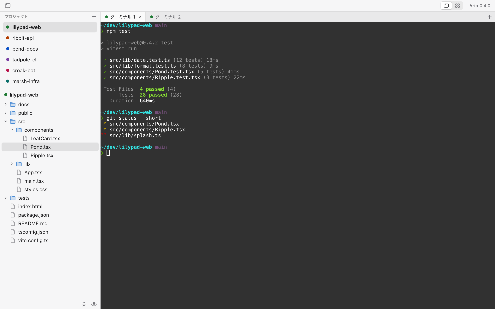
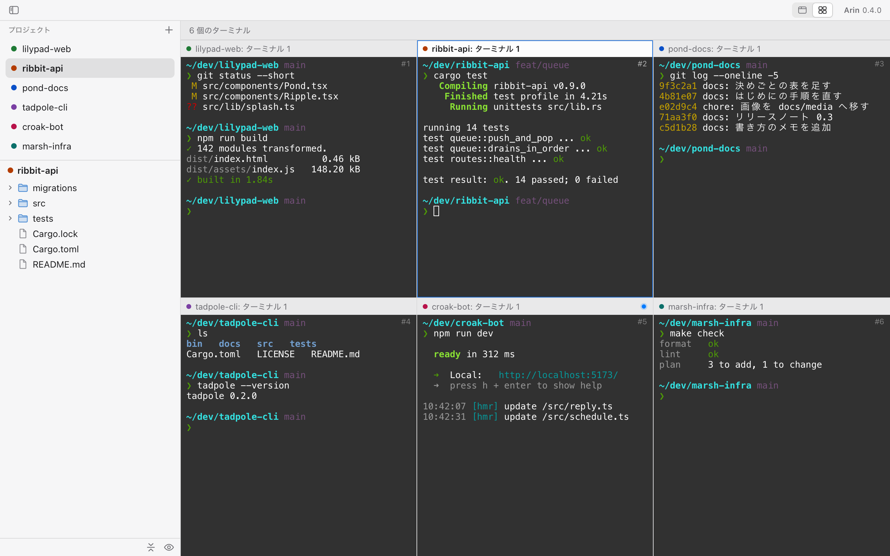
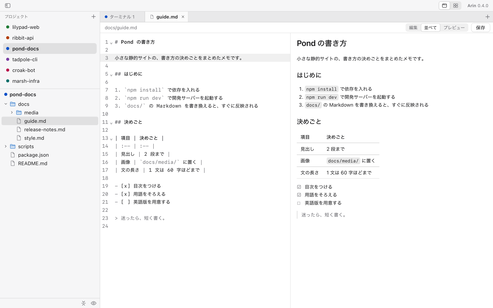

# Arin


プロジェクトごとのターミナルとファイルツリーを、1 つのウィンドウにまとめる macOS 向けの軽いマルチターミナルです。
「VSCode をプロジェクトの数だけ開き、統合ターミナルで AI エージェントを動かしているだけ」という使い方から、エクスプローラとターミナルだけを抜き出しました。

> Arin(アリン)はバスク語で「軽い・素早い」。American Registry for Internet Numbers(ARIN)とは関係がありません。

- 紹介ページ: <https://froggugugugu.github.io/arin-term/>
- 動作環境: macOS 15 以降、Apple silicon の Mac

<picture>
  <source media="(prefers-color-scheme: dark)" srcset="docs/media/tabs-dark.png" />
  
</picture>

## できること

- **プロジェクトのカードとタブ**: フォルダをプロジェクトとして登録し、サイドバーのカードで切り替えます。ターミナルのタブはプロジェクトごとに持ち、ツリーとターミナルはいつも同じプロジェクトを指します。カードとタブには、プロジェクトごとの色の印が付きます
- **タイル表示**: すべてのプロジェクトのターミナルを自動のグリッドで同時に並べます(1 ページに 9 枚まで、超えた分はページ送り)。タイルの右上の「#1」〜「#9」の番号で、`⌘1`〜`⌘9` でそのタイルへ移れます。フォーカスしていないタイルや別のページでベルや通知(OSC 9 / 777)が出ると、印で知らせます
- **ファイルツリー**: ファイルの追加・変更をすぐに反映します。新規作成・名前の変更・切り取り / コピー / ペースト・ゴミ箱に入れる・ツリーの中でのドラッグに対応し、ファイルをターミナルへドラッグするとパスが入ります。相対パス・絶対パスのコピー、Finder で表示、既定のアプリで開く、もできます
- **Markdown のエディタ**: `.md`・`.markdown` のファイルは、ターミナルのタブと並ぶエディタのタブで開きます。編集・並べて表示・プレビューを切り替え、`⌘S` で保存します。設定で Vim のキー操作に切り替えられます。ほかの種類のファイルは編集しません
- **文字の大きさと透過**: 設定画面(`⌘,`)で、ターミナルとエディタの文字、画面の文字、ウィンドウの透過、ターミナルの背景の透過を変えられます
- **ショートカットの設定**: キーは設定ファイル `settings.toml` で変えられ、保存するとアプリを動かしたまま効きます
- **Shift+Enter の改行**: ターミナルで Shift+Enter を押すと、ESC と CR を送ります(AI エージェントの入力欄で、送らずに改行する用途)

<picture>
  <source media="(prefers-color-scheme: dark)" srcset="docs/media/tiles-dark.png" />
  
</picture>

<picture>
  <source media="(prefers-color-scheme: dark)" srcset="docs/media/editor-dark.png" />
  
</picture>

*写っているプロジェクト・パス・出力はすべて架空のものです。画像はブラウザで撮ったもので、実アプリの窓の向こうが透ける見た目(すりガラス)は写っていません。*

## インストール

配布版は Apple silicon の Mac(macOS 15 以降)向けです。配布物は Developer ID で署名し、Apple の公証を受けたものを [GitHub Releases](https://github.com/froggugugugu/arin-term/releases) に出します。

### コマンドで入れる

```bash
curl -fsSL https://froggugugugu.github.io/arin-term/install.sh | bash
```

最新版の `Arin-<版>-arm64.zip` をダウンロードし、GitHub が記録した sha256 と署名を確かめてから「アプリケーション」フォルダ(書き込めなければ `~/Applications`)に入れて起動します。更新も同じコマンドです。Arin が動いているときは止めずに置き換え、次に開いたときから新しい版になります(動いているシェルを道連れにしないため)。中身は [scripts/install.sh](scripts/install.sh) です。

| 環境変数 | 意味 |
| -------- | ---- |
| `ARIN_INSTALL_VERSION=0.4.0` | 最新版の代わりにこの版を入れる |
| `ARIN_INSTALL_APP_DIR=DIR` | `DIR` に入れる |
| `ARIN_INSTALL_ZIP=FILE` | ダウンロード済みの `Arin-<版>-arm64.zip` から入れる |
| `ARIN_INSTALL_NO_OPEN=1` | 入れたあと起動しない |

例: `curl -fsSL https://froggugugugu.github.io/arin-term/install.sh | ARIN_INSTALL_NO_OPEN=1 bash`

### DMG をダウンロードする

1. [最新のリリース](https://github.com/froggugugugu/arin-term/releases/latest)から `Arin-<版>-arm64.dmg` をダウンロードして開き、`Arin.app` を「アプリケーション」フォルダへドラッグします
2. 起動します。初回に「インターネットからダウンロードされたアプリケーションです。開いてもよろしいですか?」と出たら「開く」を押します

### ソースからビルド

必要なもの:

- macOS 15 以降、Apple silicon の Mac
- Xcode Command Line Tools(`xcode-select --install`)
- Rust([rustup](https://rustup.rs/))。版は [rust-toolchain.toml](rust-toolchain.toml) の指定で自動的にそろいます
- Node.js 24 以降と npm

```bash
git clone https://github.com/froggugugugu/arin-term.git && cd arin-term
npm ci
npm run app
```

できあがった `target/aarch64-apple-darwin/release/bundle/macos/Arin.app` を「アプリケーション」フォルダへ移します。素の `cargo build` ではなく `npm run app` を使ってください(最低の OS の指定は `tauri build` が渡します)。

## 使い方

1. サイドバーの「プロジェクト」の `+` でフォルダを選び、プロジェクトとして登録します。登録したフォルダの中に、Arin は設定ファイルを書きません
2. カードを選ぶと、そのプロジェクトのツリーとターミナルが出ます。`⌘T` でタブを足します
3. ツリーのファイルをターミナルへドラッグするか、選んで `⌘↩` を押すと、ターミナルにパスが入ります
4. `⇧⌘G` でタイル表示に切り替え、`⌘1`〜`⌘9` でタイルを移ります

登録したプロジェクトと並び・選んでいたプロジェクト・表示モード・ペインの大きさ・文字の大きさと透過は、次の起動で戻ります(保存先は `~/Library/Application Support/Arin/state.json`)。ターミナルとエディタのタブは戻らず、シェルのプロセスもアプリの終了をまたいで残りません。動いているコマンドがあれば、終了の前に確認します。

## キーの一覧

既定のキーです。`⌘C`・`⌘X`・`⌘V` 以外は [設定ファイル](#設定ファイル) で変えられます。

| 場面 | キー | 動作 |
| ---- | ---- | ---- |
| アプリ | `⌘,` | 設定画面を開く |
| | `⌘Q` | 終了 |
| ターミナル | `⌘T` | 新規タブ |
| | `⌘W` | タブを閉じる |
| | `⇧⌘[` / `⇧⌘]` | 前のタブ / 次のタブ |
| | `Shift+Enter` | ESC と CR を送る(改行) |
| 編集 | `⌘C` / `⌘X` / `⌘V` | コピー / 切り取り / ペースト(変えられません) |
| | `⌘A` | すべてを選択 |
| 表示 | `⇧⌘G` | タイル表示とタブ表示を切り替える |
| | `⌥⌘←` / `⌥⌘→` | 前のページ / 次のページ(タイル表示) |
| | `⇧⌘↩` | タイルを拡大 / 元に戻す |
| | `⌘1`〜`⌘9` | その番号のタイルにフォーカス(タイル表示) |
| ツリー | `⌘O` | 開く(`.md`・`.markdown` はエディタ、ほかは既定のアプリ) |
| | `⌘↩` | パスをターミナルに挿入 |
| | `⌥⌘C` / `⇧⌥⌘C` | 絶対パス / 相対パスをコピー |
| | `⌥⌘R` | Finder で表示 |
| | `↩` | 名前を変える |
| | `⌘N` / `⇧⌘N` | 新規ファイル / 新規フォルダ |
| | `⌘⌫` | ゴミ箱に入れる |
| エディタ | `⌘S` | 保存 |

キーの一覧の正本は [src/ipc/generated/defaultShortcuts.json](src/ipc/generated/defaultShortcuts.json)(Rust の既定の表から生成)です。

## 設定ファイル

ショートカットのキーは `~/Library/Application Support/Arin/settings.toml` で変えます。設定画面の「設定ファイルを開く…」を押すと、ファイルが無ければ、既定のキーをすべてコメントで並べた見本を作って開きます。

```toml
[shortcuts]
"terminal.new-tab" = "Cmd+Shift+T"
"view.toggle-display-mode" = "Cmd+Alt+G"
```

- 1 行に 1 つ、`"コマンドの ID" = "キー"` の形で書きます。修飾キーは `Cmd`・`Shift`・`Alt`・`Ctrl`
- 保存すると、アプリを動かしたまますぐに効きます。問題のある行はその行だけ既定に戻り、画面に 1 行で理由が出ます
- アプリがこのファイルを書き換えることはありません
- 文字の大きさと透過は設定画面で変えます(保存先は `state.json`)

書き方の決まり・割り当てられないキー・効かないときの確かめ方は、作られる見本の先頭に書いてあります。

## プライバシー

Arin は外部と通信しません。

- 画面(WebView)は、Content Security Policy で通信先を Tauri の内部の通信と自分のアプリだけに絞っています([src-tauri/tauri.conf.json](src-tauri/tauri.conf.json) の `csp`)
- 画面のソースに通信の API(`fetch` など)を書かない規則を、`npm run lint` の境界の検査([scripts/check-boundaries.mjs](scripts/check-boundaries.mjs))が確かめています
- Markdown のプレビューは画像を読み込まず、リンクも開きません
- 利用状況の収集・クラッシュの送信・自動更新はありません。インストールのスクリプトだけが、ダウンロードのために GitHub に接続します

規則の一覧は [docs/development-patterns.md](docs/development-patterns.md) の「境界の規則」にあります。

## やらないこと

軽さを保つため、次のものは持ちません([PRD の非ゴール](output/prd/PRD_multi-terminal.md))。

- テキストエディタ・差分ビューア・LSP・拡張機能(例外は Markdown のファイルの編集とプレビューだけ)
- ファイルの中身の全文検索・差分・プレビュー(Markdown を除く)、git の操作
- 内蔵ブラウザ、AI エージェントのオーケストレーション、CLI やソケットからの外部操作
- アプリの終了をまたいだシェルの維持(tmux の detach / attach に当たるもの)
- SSH やリモートへの接続、Windows・Linux への対応
- Mac App Store での配布、自動アップデート、多言語化
- 任意の位置・比率でのペインの分割(同時に見るのはタイル表示の自動グリッドだけ)

## 既知の制限

- 配布版は Apple silicon の Mac だけです
- Markdown のエディタ: 日本語入力の変換中に `⌘S` を押しても保存が走ります。アプリ内でファイルの名前を変えたりゴミ箱に入れたりしても、開いているエディタのタブは追従しません。編集とプレビューのスクロールは連動しません
- タイルの番号の札は、ターミナルの 1 行目の右端に重なります(右寄せのプロンプトや TUI の右上の文字が読みにくくなることがあります)
- `Shift+Enter` は表の外の決まった動きで、設定ファイルで別のコマンドに割り当てても効きません。送るのは ESC と CR で、それをどう受け取るかはシェルやアプリによります
- `settings.toml` がシンボリックリンクのとき、リンク先の変更は拾えません。保存のあとにリンク自体を `touch` するか、再起動してください
- macOS の「キーボードショートカット」や入力ソースの切り替えが使っているキーは、先に macOS が受けるので効きません
- 実機での確認がまだ済んでいない項目があります(各マイルストーンの合否一覧 [output/reports/test/](output/reports/test/) の「本人の確認」)

## このリポジトリの作られ方

Arin は、AI のコーディングエージェント(Claude Code)が、開発の進め方のテンプレート [project-blueprints](https://github.com/froggugugugu/project-blueprints)(MIT)に沿って作ったものです。要求から設計・実装・検証までの記録を、消さずにそのままリポジトリに入れています。

| 段階 | 置き場所 |
| ---- | -------- |
| 要求メモ | [input/requirements/](input/requirements/) |
| PRD(製品要求仕様) | [output/prd/](output/prd/) |
| 設計と ADR(設計判断の記録。15 件) | [output/design/](output/design/) |
| 実装の計画と進捗 | [output/tasks/](output/tasks/) |
| マイルストーンごとの合否一覧 | [output/reports/test/](output/reports/test/) |
| レビュー・セキュリティ・ライセンスの点検 | [output/reports/](output/reports/) |

人間と AI の分担は [AGENTS.md](AGENTS.md) と [constitution.md](constitution.md) で決めています。

- **人間が決めること**: 要求メモ、`project-config.md` の大半(技術の選び方・品質の基準・方針)、PRD・設計・タスク分解・実装・検証の 5 つの関門での判断、非ゴールの変更、秘密情報の扱い、実機での体感の確認、push やリリースなど外へ出る操作
- **AI がやること**: PRD・設計書・ADR・計画の作成、実装とテスト、合否一覧の作成、`docs/` と `output/` の更新。曖昧な点は推測で進めず、選択肢を付けて【要確認】として人間に返します
- 守るべきことの一部(秘密情報のファイルを読まない、`--no-verify` を使わない、など)は、指示文ではなく Claude Code のフックと権限の設定([.claude/](.claude/))で止めています

数字(この README を足す前、2026-11-17 の時点): コミットは 186 件(2026-11-14〜11-17)で、そのうち 185 件に AI の共著の印(`Co-Authored-By: Claude`)があります。画面の自動テスト(`npm run e2e`)は 286 件です。

## 開発

```bash
npm ci
npm run dev            # 開発起動(Tauri)
npm test               # Vitest + cargo test + node --test
npm run lint           # 型検査・Biome・clippy・rustfmt・境界の検査
npm run e2e            # 画面の自動テスト(Playwright の WebKit。Rust 側は偽物に差し替え)
npm run app            # 配布用の .app
npm run screenshots    # README と紹介ページの画像を docs/media/ に撮り直す
```

コマンドの一覧は [docs/project.md](docs/project.md)、構成は [docs/architecture.md](docs/architecture.md)、署名・公証とリリースの手順は [docs/release-notarization.md](docs/release-notarization.md) にあります。

| ディレクトリ | 内容 |
| ------------ | ---- |
| `src/` | 画面(React + TypeScript。xterm.js・CodeMirror) |
| `src-tauri/` | Tauri のアプリ(コマンド・メニュー・状態の保存) |
| `crates/arin-core/` | 入出力を持たない規則(プロジェクト・タイル・ショートカットの表など) |
| `crates/arin-platform/` | OS との入出力(PTY・ファイル操作・監視・macOS の API) |
| `e2e/` | 画面の自動テスト(`e2e/screenshots/` は画像を撮る専用) |
| `docs/media/` | README と紹介ページの画像 |
| `.github/pages/` | 紹介ページ(GitHub Pages) |
| `scripts/` | 境界の検査・スモーク・配布物の作成・インストーラー |

## ライセンス

[MIT](LICENSE)。依存のライセンス表示は [THIRD_PARTY_NOTICES.md](THIRD_PARTY_NOTICES.md) と [THIRD_PARTY_LICENSES.md](THIRD_PARTY_LICENSES.md) にあり、配布アプリにも同梱しています(`Arin.app/Contents/Resources/licenses/`)。

macOS は Apple Inc. の商標です。
