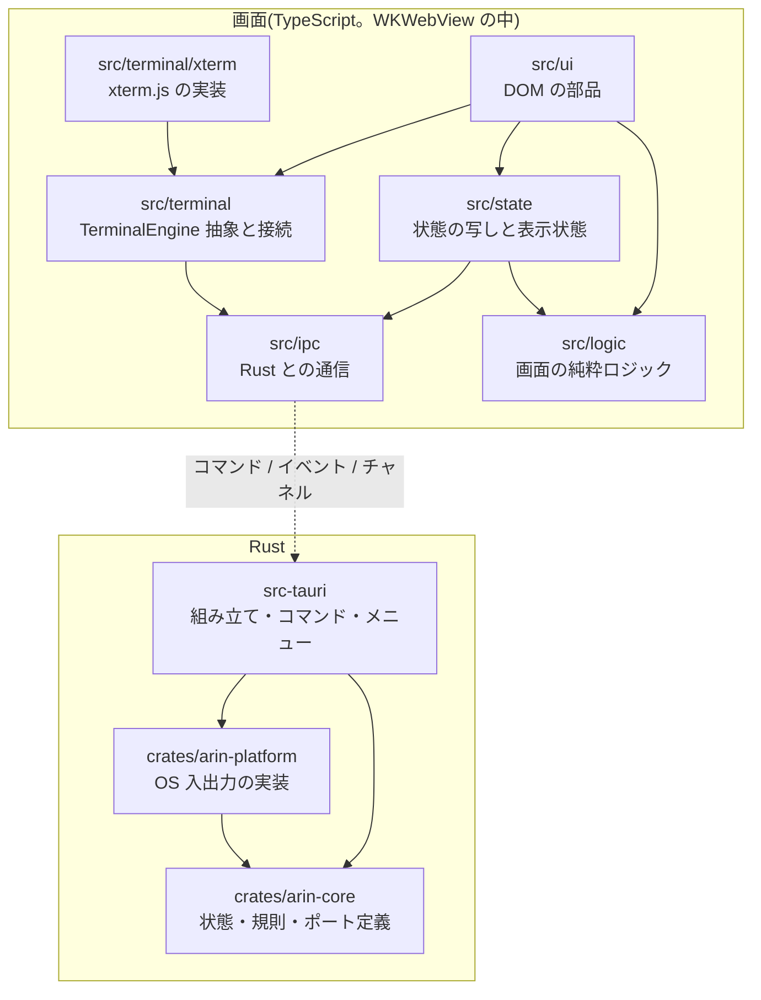

# アーキテクチャ: ライト・マルチターミナル「Arin」

> 生成元: `output/prd/PRD_multi-terminal.md`(承認済み。FR-001〜064、NFR-001〜009)
> 参照: `project-config.md` §1〜§3・§6、過去作 `froggugugugu/tadcap`(Tauri 2)、`froggugugugu/mdslide`(Electron。参考程度)
> 生成日: 2026-11-14
> 改訂: 2026-11-15 M2 の実装で決まったこと・食い違いを反映(計画 T28b。Rust 側と決定済みのことだけ。差分は本人の確認待ち。画面側は T36 で直す)
> ステータス: 承認済み(2026-11-14、設計ゲート通過。本人承認。§15.1 の 12 件は確定、§15.2 の仮定 12 件は異論なし)

**この文書の読み方**

- 実装技術は Tauri(Rust + TypeScript)で確定している(PRD §7 C3)。それ以外の技術選定(画面のフレームワーク、PTY のクレート、設定ファイルの形式、テストの方式、ロジック層の置き場所など)は、2026-11-14 の設計ゲートで本人が選んだ。結果は §15.1。
- 本文は §15.1 の推奨案を採った場合の姿で書いた。**#2(画面のフレームワーク)だけは推奨と違う React + zustand が選ばれた。** 本文は React 前提に直してある(§2・§6・§7・§9 は設計ゲートの時点で、§3・§4・§9〜§12 は M0 の T1 で直した)。依存の正確な版と部品のテスト方針は ADR-003。
- 将来の要望として、画面をリッチにすることと簡易 Markdown エディタ(mdslide 程度)が挙がっている。React を選んだ理由はこれ。ただし**エディタは現状、非ゴール N1(テキストエディタ)と N7(ファイルの中身に触れる機能)に当たるため、本設計の対象外**。入れるには要求メモの非ゴールの変更(人間ゲート)と PRD の改版が要る。
- 「確認済み」は今回この Mac で実際に動かすかソースを読んで確かめたこと(§1.4)。「未検証」は確かめていないこと。未検証の点は §2.2(M1 で確かめる)と §15.3(それ以降に確かめる)に集めた。
- 【要確認】はユーザーの判断が要る箇所、【仮定】は本書が置いた前提。どちらも §15 に集約した。
- 非ゴール N1〜N7(PRD §1.2)は変更していない。PRD §10 の回答(C-01〜C-25)は確定事項として扱った。性能値 NFR-001〜005・009 は目安で、合否判定には使わない。
- Swift 版の設計草案からは、技術に依存しない判断だけを引き継いだ(状態ファイル 1 本と版番号と原子的な書き込み、上書きしない API だけを使う、アテンションは PTY の生出力を走査する、監視は選択中プロジェクトに絞る、仮定 6 件)。
- 用語: 「正本」は、ある状態について唯一の正しい値を持つ場所のこと。「画面」は Tauri が表示する WebView(macOS 標準の WKWebView)の中で動く TypeScript のコードを指す。

---

## 1. アーキテクチャ概要

### 1.1 設計方針

| # | 方針 | 根拠 |
| - | ---- | ---- |
| 1 | 状態と規則の正本を Rust に置く。画面は Rust から届いた状態を映し、操作を Rust に伝える | PRD §7 C5(画面のコードは薄く)。§1.3 #1 |
| 2 | 依存方向をビルドで強制する。Rust はクレートの依存宣言、TypeScript はプロジェクト参照で、違反はコンパイルエラーになる | `project-config.md` §2「依存方向チェック」、PRD §7 |
| 3 | ターミナルエンジン(xterm.js)は `src/terminal/xterm/` だけが知る。画面の他の部分は抽象(`TerminalEngine`)だけを使う | PRD §7 C4 |
| 4 | OS への入出力(ファイル操作、監視、PTY、ブックマーク、状態ファイル)は Rust のポート(trait)越しに呼ぶ。ロジックは偽の実装で、OS 側は一時ディレクトリでテストする | PRD §8 |
| 5 | ファイルを失わない。上書きしない API だけを使い、削除はゴミ箱、判定は実行の瞬間に行う。判定は Rust 側に置き、画面から迂回できないようにする | FR-028・030・035・036、PRD §11 |
| 6 | 外部通信をしない。通信できる部品を入れず、画面側は CSP で塞ぎ、検査スクリプトで確かめる | NFR-008 |
| 7 | 追加ライブラリは最小限にし、理由を ADR に残す。過去作 tadcap で使った構成を優先する | PRD §7 C6 |

### 1.2 システム構成図

ビルド単位の依存関係(矢印は「依存する」向き)。



実行時の構成。

```text
┌─ Arin.app ──────────────────────────────────────────────────────────────┐
│ メインプロセス(Rust)                                                   │
│  ├─ Workspace(状態の正本。SessionRegistry の Mutex の中)… arin-core   │
│  ├─ ターミナルごと: PTY + 読み取り・まとめのスレッド + アテンション走査 │
│  ├─ ファイル監視(選択中プロジェクトのルートに FSEvents。M3)           │
│  ├─ 見回り(1 秒間隔): ルートフォルダの現在位置。前面プロセスは M6     │
│  └─ 状態ファイルの書き込み(専用スレッド 1 本。0.5 秒まとめ)           │
│        ▲ コマンド(操作)        │ イベント(状態の写し)                │
│        │                         ▼ チャネル(PTY の出力。生バイト)      │
│ WebKit の補助プロセス(WKWebView。TypeScript)                           │
│  ├─ 状態の写し → カード / ツリー / タブ / タイルを描画                  │
│  └─ ターミナルごとに xterm.js のインスタンス 1 個(非表示でも保持)     │
└──────────┬──────────────────────────────────────────────────────────────┘
           │ PTY(ターミナル 1 枚につき 1 組)
   ┌───────┴────────┐
   │ ログインシェル │ × ターミナルの枚数(子プロセス。互いに独立)
   └────────────────┘
```

### 1.3 主要な設計判断(提案)

| # | 判断事項 | 提案内容 | 理由 |
| - | -------- | -------- | ---- |
| 1 | ロジック層の置き場所 | 状態と規則は Rust の `arin-core`。画面にどう並べるかの計算(ツリーの行、ドラッグ、キーの振り分け)だけ TypeScript の `src/logic`。振り分けの基準は §3.4 | ファイルを書き換える判定を画面から迂回できない。ウィンドウが隠れていても動く。依存方向をクレート境界で強制できる。別案は §15.1 #1 |
| 2 | PTY の持ち方 | Rust 側でターミナル 1 枚につき PTY 1 組とスレッド 2 本(PTY の読み取りと、まとめて送る処理)を持つ。PTY は画面が最初に接続したときに起動する | 接続前の出力を取りこぼさない。1 枚の異常が他へ波及しない(NFR-006) |
| 3 | 出力の流し方 | Tauri のチャネルで生バイトを画面へ送る。Rust 側で短い時間ぶんをまとめ、画面が処理し終えた量を返すまで読み取りを止める(流量制御) | NFR-004・009。ローカルのソケットを開かずに済む(NFR-008) |
| 4 | ターミナルの保持 | 1 ターミナル=xterm.js のインスタンス 1 個。非表示のあいだも破棄せず、置き場所の要素を画面から隠すだけにする | FR-042・052(非表示側の継続)と NFR-009(表示中だけ描画)を同じ仕組みで満たす。スクロールバックは xterm.js が持つ |
| 5 | アテンションの検出 | PTY の生出力を `arin-core` の走査器で調べ、BEL と OSC 9/777 を拾う | エンジンに依存しない(C4)。ウィンドウが隠れていても検出でき、macOS 通知を出せる。PRD §8 の単体テスト項目に当たる |
| 6 | ウィンドウが隠れたとき | Tauri の設定 `backgroundThrottling` を `disabled` にする | WKWebView は隠れたビューのタイマーを抑え、約 5 分で処理を止めることがある(§1.4 #9)。止まると出力の表示が進まない |
| 7 | ファイル監視の範囲 | 再帰の監視は選択中プロジェクトだけ。除外フォルダのイベントは Rust 側で捨て、画面へ送らない。他のプロジェクトは選択時に読み直す | PRD §7 C7。FR-014 は表示中のツリーが対象 |
| 8 | ルートの記憶 | macOS のブックマークと、最後に分かっていたパスの 2 つを保存する。動作中は、開いたままにしたフォルダの現在位置を見回りで調べる | FR-007。どちらも改名と移動に追従することを確認した(§1.4 #12・#13) |
| 9 | 状態ファイル | `state.json` 1 ファイル。`schemaVersion` を持ち、原子的に書き込む。壊れていたら退避して空で始める | FR-056・058、PRD §5 |
| 10 | 設定ファイル | アプリは読むだけで書き換えない。保存を検知して読み直す | 人が書いたコメントや並びを壊さない。設定画面を持たない(N5) |
| 11 | 上書きの禁止 | 新規作成・移動・コピーは「既にあれば失敗する」API だけで実装する。「置き換える」は既存をゴミ箱へ入れてから置く | FR-030 を構造で保証する。FR-028 の「戻せる」とも揃う。API の動作は確認済み(§1.4 #14) |
| 12 | ログインシェルの起動 | 環境変数を許可リストから組み立て、`argv[0]` を `-zsh` の形にして起動する(§7.1) | FR-040。確認済み(§1.4 #11) |
| 13 | アプリ内のドラッグ | ツリー内の移動、ツリーからターミナルへの挿入、カードの並び替えは、マウスのイベントで自前に実装する(HTML 標準のドラッグ機能を使わない)。Finder からのドロップは Tauri の機能で受ける | Tauri が Finder からのドロップを受ける設定のとき、HTML 標準のドロップは画面に届かない見込み(§1.4 #8) |
| 14 | 確認ダイアログとメニュー | 確認ダイアログ(削除・終了・移動・名前衝突)とコンテキストメニューは画面内に描く。フォルダ選択ダイアログとメニューバーは macOS 標準 | Playwright で自動テストできる。メニュー表示中の更新保留(FR-037)が素直に書ける。別案は §15.1 #9 |
| 15 | 実行中の判定 | PTY の前面プロセスグループを 1 秒間隔で調べ、シェル以外なら「実行中」とする。M2 では削除と終了の確認のときだけ調べ(`PtySession::foreground`)、1 秒の見回りでの判定は M6【仮定】 | FR-012・046。確認済み(§1.4 #11) |
| 16 | 異常終了の扱い | リリースビルドで `panic = "abort"` を使わない(tadcap とは変える) | 1 本のスレッドの異常でアプリ全体が落ちるのを避ける(NFR-006) |

### 1.4 設計時に確認した事実(2026-11-14)

推奨の根拠にした事実。検証用のコードはスクラッチパッドに置き、リポジトリには入れていない。

| # | 事実 | 確認方法 |
| - | ---- | -------- |
| 1 | この Mac には Rust 1.98.1(stable、aarch64-apple-darwin。clippy と rustfmt 入り)、Node v24.15.0、npm 11.12.1 がある。pnpm 10.30.1 と bun 1.3.14 もある | `rustc --version`、`rustup component list --installed`、`node --version` など |
| 2 | Tauri CLI は単体では入っていない(`cargo tauri` は `no such command`)。tadcap と同じく npm の開発用依存として入れるので支障はない。`cargo-llvm-cov` は無い。`cargo audit` はある | `cargo tauri --version`、`cargo --list` |
| 3 | Xcode は無く Command Line Tools だけ。Tauri の公式手順は、デスクトップだけなら Command Line Tools で足りるとしている。`notarytool`・`stapler`・`codesign` はある | `xcode-select -p`、`xcrun --find`、Tauri 公式の前提条件ページ |
| 4 | tadcap の構成: Tauri 2.12.5(wry 0.57.1)。画面はフレームワークなしの TypeScript、Vite 8、Vitest 5、TypeScript 6.0、npm。lint の設定ファイルは無く、`tsc` の厳格オプションと `cargo clippy -- -D warnings` で検査している | tadcap の `package.json`、`src-tauri/Cargo.toml`、`Cargo.lock`、`.github/workflows/release.yml` |
| 5 | tadcap の Playwright は Tauri を起動しない。Vite の開発サーバーが配るページを Chromium で開き、Rust との通信を偽物に差し替えている | tadcap の `playwright.config.ts`、`e2e/fixtures/tauriMock.ts` |
| 6 | tadcap の署名と公証: Tauri が `.app` を署名・公証し、`scripts/package-mac.sh` が `.dmg` を署名・公証・staple して検証する。認証は App Store Connect の API キー。エンタイトルメントのファイルは無い | tadcap の `scripts/package-mac.sh`、`.github/workflows/release.yml`、`docs/release-notarization.md` |
| 7 | 最新版: tauri 2.12.5(3.0 は alpha)、`@tauri-apps/cli` 2.12.4、`@xterm/xterm` 6.0.0、Playwright 1.65.1、Vite 8.3.8、Vitest 5.1.0、TypeScript 7.0.2(tadcap は 6.0 系) | crates.io の API、`npm view` |
| 8 | Tauri が Finder からのドロップを受ける設定(既定)のとき、macOS ではドラッグの受け口が WebKit の既定処理を呼ばずに戻る。ドロップのイベントが持つのはパスと座標だけで、修飾キーは無い | wry 0.57.2 `src/wkwebview/drag_drop.rs`、tauri-runtime-wry 2.12.3 のソース。実機では未実行 |
| 9 | Tauri に `backgroundThrottling` の設定があり、macOS 14 以降で効く。説明には、隠れたビューはタイマーが抑えられ約 5 分で処理が止まるとある | tauri-utils 2.10.2 `src/config.rs`、wry 0.57.2 のソース。実機では未実行 |
| 10 | Tauri のチャネルは生バイトを送れる。1024 バイト未満は直接、それ以上は取りに来させる方式で渡す | tauri 2.12.5 `src/ipc/channel.rs` |
| 11 | `portable-pty` 0.9.0 はこの Mac でビルドでき、次が動く: ログインシェルの起動(`argv[0]` が `-zsh`、ログインかつ対話)、最小の環境変数から始めて PATH が 16 件に組み立てられ `claude` が見つかる、前面プロセスグループがシェルと実行中のコマンドで変わる、行・桁数の変更が端末に届く | スクラッチパッドの最小プログラムを `cargo run` |
| 12 | macOS のブックマークは改名に追従する(改名後に解決すると新しい名前が返る)。削除後は解決に失敗する。**M2(T28)の追記**: Rust から `objc2-foundation` 0.3.2 の `NSURL` で作成・解決できた(セキュリティスコープなし)。改名・別の親への移動のあとは新しいパスと `stale=true` が返る。既知の制約: 消したあと同じパスに別のフォルダがあるとそこに解決される。改名後に元の名前で新しいフォルダを作ると新しい方に解決される。どちらもアプリを止めているあいだの操作で起きる(起動中は見回りが先に作り直す)。受け入れる【仮定】 | Swift のスクリプト。M2 で Rust の小さなプログラム(PROGRESS の T28)と `arin-platform` のテスト |
| 13 | 開いたままにしたフォルダは、改名しても移動しても現在のパスを取得できる(`fcntl` の `F_GETPATH`)。**M2 の訂正**: 削除後も `F_GETPATH` は消える前のパスを返す。実装(`arin-platform/src/watch/`)は、記述子の `fstat` が `ENOENT` になることと、返ったパスにあるものの装置番号・inode が開いたフォルダと一致するかで「見つからない」を判定する | Python のスクリプト。M2 で `arin-platform` のテスト(macOS 26、APFS。ADR-009) |
| 14 | `renamex_np`(`RENAME_EXCL`)と `copyfile`(`COPYFILE_EXCL`)は、移動先・コピー先が既にあると何も変えずに失敗する。`libc` 0.2.191 に定義がある | Python のスクリプト、`libc` のソース |
| 15 | ゴミ箱に入れる標準の API(`NSFileManager` の `trashItemAtURL`)は、一部の環境で Finder の「戻す」が出ないと `trash` クレート 5.3.0 が文書に書いている。Finder に頼む方式は「戻す」が出るが、権限の確認が出ることがある | `trash` 5.3.0 `src/macos/mod.rs` のドキュメントコメント。この Mac では未検証 |
| 16 | xterm.js 6.0.0 は canvas 描画を廃止した。描画は DOM か WebGL。同期出力(DEC 2026)に対応した。日本語入力で英数キーで確定すると文字が二重になる不具合(#5778)と、WKWebView での韓国語入力の不具合(#5704)が未解決 | xterm.js 6.0.0 のリリースノート、GitHub の issue |
| 17 | TypeScript のプロジェクト参照を使うと、ロジック層から画面層を import した時点と、ロジック層で DOM を使った時点でコンパイルエラーになる | TypeScript 6.0.3 の最小構成で `tsc -b`(TS6307、TS2584) |
| 18 | Tauri 公式の WebDriver は macOS で使えない(WKWebView 用のドライバが無い)。WebdriverIO の `@wdio/tauri-service` は、アプリに WebDriver のサーバーを埋め込む方式で macOS に対応している(プラグインは 2026-05 公開、1.5.1) | Tauri 公式の WebDriver のページ(2026-06-29 更新)、crates.io |
| 19 | `objc2-app-kit` 0.3.2 に、Finder で選択表示、開けるアプリの一覧、ペーストボードの読み書き、修飾キーの取得がある。Tauri が既に使っているクレート | `objc2-app-kit` のソース |

---

## 2. 技術スタック

「確定」は PRD で決まっているもの。「推奨」は設計ゲートで確定する。「踏襲」は tadcap と同じ選択。

| カテゴリ | 技術 | バージョン | 選定理由 |
| -------- | ---- | ---------- | -------- |
| アプリの土台 | Tauri | 2.12 系 | 確定(PRD §7 C3)。tadcap と同じ系列。3.0 は alpha のため使わない |
| 言語(Rust 側) | Rust | 1.98.1(`rust-toolchain.toml` で固定) | 確定。版を固定して CI と手元を揃える |
| 言語(画面側) | TypeScript | 6.0 系 | 推奨・踏襲。7.0 系はプロジェクト参照の動作を確かめていない |
| 画面のフレームワーク | React + zustand | `react` 19.3.1、`react-dom` 19.3.1、`zustand` 5.0.16、`@vitejs/plugin-react` 6.1.2、`@types/react` 19.3.0、`@types/react-dom` 19.3.0 | 確定(§15.1 #2。推奨の「なし」ではなく本人が選択)。版の根拠は ADR-003 |
| ビルド(画面側) | Vite | 8 系 | 推奨・踏襲 |
| パッケージ管理 | npm | 11 系 | 推奨・踏襲 |
| ターミナルエンジン | xterm.js(`@xterm/xterm`) | 6.0.0 に固定 | 確定(M1 の Go/No-Go で Go。2026-11-15。ADR-001) |
| ターミナルの描画方式 | DOM(xterm.js の既定) | — | 確定(2026-11-16): DOM に固定する。M1〜M4 は WebGL(`@xterm/addon-webgl` 0.19.0)を起動時の指定 `ARIN_RENDERER=webgl` で切り替えられるようにして比べ、M4 の 9 枚の実測のあと本人が DOM のままを選んだので、WebGL と起動時の指定を外した(ADR-001) |
| xterm.js のアドオン | `addon-fit`(寸法合わせ)0.11.0、`addon-unicode11` 0.9.0(全角幅・絵文字。固定)、`addon-search`(FR-047)、`addon-web-links`(FR-047) | 左に記載。search と web-links は入れるときに選ぶ | fit と全角幅は確定(ADR-001。`addon-unicode-graphemes` 0.4.0 は M4 まで `ARIN_UNICODE=graphemes` で比べ、2026-11-16 に外した)。search と web-links は FR-047 を作るとき(M6 の T61)に入れる |
| PTY | `portable-pty` / `pty-process` / 自前実装 | 0.9.0 | 確定(§15.1 #3)。`portable-pty` |
| ファイル監視 | FSEvents。`notify` クレート経由 | 8.2 系 | FSEvents は確定(PRD §7 C7)。クレートは推奨 |
| macOS の API 呼び出し | `objc2`、`objc2-foundation`、`objc2-app-kit`、`libc`、`base64`(ブックマークを文字列にする) | =0.6.5 / =0.3.2 / =0.3.2 / =0.2.191 / =0.23.1 | 確定(M2。ADR-009)。どれも Tauri が使っている版と同じで、`Cargo.lock` に新しいクレートは増えない。使うのは `arin-platform` だけ |
| 状態の永続化 | JSON(`serde_json`) | 1 系 | 確定(FR-056) |
| 設定ファイル | TOML / 厳密な JSON / コメント付き JSON | — | 確定(§15.1 #4)。TOML |
| Rust と TypeScript の型合わせ | `ts-rs` で生成 / 手書きと照合テスト | 12 系 | 確定(§15.1 #7)。`ts-rs` |
| フォルダ選択ダイアログ | `NSOpenPanel` を `objc2-app-kit` で直接呼ぶ | (上の `objc2-app-kit`) | 確定(M2。ADR-009 の追記)。`tauri-plugin-dialog` は `tauri-plugin-fs` を外せない依存に持つ(§12 に反する)ため使わない |
| スタイリング | 素の CSS とカスタムプロパティ | — | 推奨・踏襲 |
| アイコン | 自作の少数の SVG | — | 【仮定】§15.2 #12。SF Symbols は画面内に埋め込めない |
| テスト(Rust) | `cargo test`、カバレッジは `cargo-llvm-cov` | 0.9 系 | 推奨。カバレッジの道具は M0 で入れる |
| テスト(TypeScript) | Vitest、カバレッジは `@vitest/coverage-v8` | 5 系 | 推奨・踏襲(§15.1 #5) |
| 画面の自動テスト | Playwright(ブラウザ方式。WebKit) | 1.65 系 | 確定(§15.1 #6) |
| コード品質 | `tsc` の厳格オプション、`cargo clippy -- -D warnings`、`cargo fmt --check`、境界検査スクリプト、React のフックの検査に Biome(`@biomejs/biome`。規則は `useExhaustiveDependencies`・`useHookAtTopLevel` の 2 つだけ) | Biome 2.6.4 | 推奨・踏襲(§15.1 #10)。Biome は M2 で追加(ADR-008) |
| 配布 | Developer ID 署名、Hardened Runtime、`notarytool`、staple。Tauri のバンドラと tadcap の `package-mac.sh` の方式 | — | 確定(PRD §7 C1)。手順は踏襲 |
| CI | GitHub Actions の `macos-26` | — | 確定(PRD §7)。ランナーとアクションの版を固定するやり方は踏襲 |

### 2.1 PTY のクレートの比較(ADR-004 の材料)

| 観点 | `portable-pty` 0.9.0 | `pty-process` 0.5.4 | 自前(`libc` の `openpty` と `fork`) |
| ---- | -------------------- | ------------------- | ------------------------------------ |
| 実績 | WezTerm の部品。ダウンロード約 2,870 万 | 約 590 万 | — |
| 最終リリース | 2025-02(約 21 か月前) | 2026-10 | — |
| この Mac での確認 | ビルドと主要動作を確認(§1.4 #11) | 未検証 | 未検証 |
| ログインシェル | 既定のシェルを `-zsh` の形で起動する機能がある | `arg0` を自分で指定する | 自分で書く |
| 前面プロセスの取得 | `process_group_leader()` がある | fd から自分で `tcgetpgrp` を呼ぶ | 自分で書く |
| 依存の数 | 多め(`nix`、`serial2`、`filedescriptor` など) | 少ない(`rustix` のみ) | `libc` のみ |
| 懸念 | 更新が止まり気味 | 実績が相対的に少ない | `fork` と制御端末の扱いを誤ると不具合になる。`unsafe` が増える |

`tauri-plugin-pty` 0.3.1 は候補から外した。`portable-pty` の薄い包みで、起動するプログラムと引数を画面側が指定する作りのため、起動の仕様を Rust 側で決める方針(§12)に合わない。

PTY は `arin-core` の `PtyPort` 越しに使うので、クレートを替えても影響は `arin-platform/src/pty/` に閉じる。

### 2.2 M1 の Go/No-Go で確かめる項目

xterm.js を WKWebView で動かしたときの挙動は、すべて未検証。M1 を検証専用にする(PRD §7)。判定は人間が行う。

結果(2026-11-15): 本人が **Go** と判断した。描画方式は DOM、全角幅は `unicode11` を既定にし、WebGL と `graphemes` は起動時の指定で切り替えられるまま M4 まで残した。M4 の 9 枚の実測のあと、本人が DOM・`unicode11` のままを選び(2026-11-16)、WebGL・`graphemes` と起動時の指定を外した。項目ごとの確認の範囲と未確認の項目は ADR-001(`ADR_001_terminal-engine.md`)。

| 分類 | 確かめること |
| ---- | ------------ |
| TUI の表示(FR-041) | truecolor、代替スクリーン、マウス、ブラケットペースト、全角幅、絵文字を Claude Code と Codex で確認する |
| 日本語入力(FR-041) | 変換中の文字が表示される。候補ウィンドウがカーソルの近くに出る。Enter での確定で文字が二重にならず、確定前に送信されない。英数キーでの確定で文字が二重にならない(§1.4 #16 の #5778)。変換中の Esc と矢印キーが効く |
| 描画方式 | DOM と WebGL のそれぞれで、`cat` で 10 万行を流したときの反応(NFR-004)、スクロール、文字のにじみ、罫線のつながりを比べる |
| 9 枚の簡易確認 | 9 個のインスタンスを並べて同時に `yes` を流し、操作が反応するかを見る。WebGL を使う場合、同時に持てる描画コンテキストの数に上限がないかを確かめる。NFR-009 の本判定は M4 だが、ここで駄目なら実装技術の見直しになるため前倒しする |
| 非表示のインスタンス | 画面から隠したインスタンスが描画処理をせず、出力の取り込みだけを続けること。隠したまま作ったインスタンスの行・桁数の決め方(表示中のターミナルと同じ寸法で始める案) |
| ウィンドウが隠れたとき | ウィンドウを最小化、または他のウィンドウで完全に覆った状態で、出力の取り込みが続くこと(§1.3 #6 の設定が効くこと) |
| キー入力 | ⌘ のショートカットと画面内のキー処理のどちらが先に受け取るか。Option キーの扱い。Ctrl の組み合わせ |
| コピーとペースト | ⌘C・⌘V で、貼り付けの許可を求める吹き出しが出ないこと |
| 流量制御 | 画面が処理し終えた量を返す方式で、大量出力のあいだもメモリが増え続けないこと。しきい値を決める |
| CSP | xterm.js は実行時にスタイルの要素を作る。tadcap と同じ厳しさの CSP(`style-src 'self'`)では動かない見込みで、どこまで緩めるかを決める(§12)。**決定**: `csp`・`devCsp` に `style-src-elem 'self' 'unsafe-inline'` と `style-src-attr 'unsafe-inline'` を足す。`style-src 'self'` は残し、`script-src` は変えない(xterm.js 6.0.0 が実行時に `<style>` 要素を作り、truecolor の文字に style 属性を書くため。ADR-001 に記録) |
| スクロールバック | 10,000 行の設定で動くこと(FR-043) |
| クリップボードの制御シーケンス | Claude Code と Codex のコピー機能が OSC 52 を必要とするか(§15.2 #9) |

No-Go のときは、原因に応じて描画方式の変更か実装技術の見直し(Swift ネイティブへ戻すことを含む)を本人が判断する(PRD §7)。

---

## 3. レイヤー構成

### 3.1 レイヤー定義

| レイヤー | ビルド単位 | 責務 | 依存可能な対象 |
| -------- | ---------- | ---- | -------------- |
| App(Rust) | `src-tauri`(クレート `arin`) | エントリーポイント。実装を生成して `Workspace` に渡す。コマンド(画面からの操作を受けて Core を呼ぶ薄い関数)、イベントの送信、メニューバー、終了の制御 | `arin-core`、`arin-platform`、`tauri`、Tauri のプラグイン |
| Platform(Rust) | `crates/arin-platform` | Core のポートの実装(ファイル操作、監視、PTY、ブックマーク、状態・設定ファイル、ペーストボード、フォルダ選択のダイアログ、Finder 連携、通知、git の HEAD 読み取り、プロセス調査、乱数・時計) | `arin-core`、`libc`、`objc2` 系、`base64`、`notify`、PTY のクレート |
| Core(Rust) | `crates/arin-core` | ドメインモデル、状態(ストア)、規則、ポート定義、ストアをまたぐ操作 | `serde`、`serde_json`、`thiserror`、`ts-rs` のみ(`ts-rs` は型の生成だけに使い、入出力をしない。T1 で追加) |
| UI(TS) | `src/ui` | DOM の部品。状態を読み、操作を呼ぶ | `src/state`、`src/logic`、`src/terminal`(抽象のみ) |
| State(TS) | `src/state` | Rust の状態の写し、表示だけの状態、操作(`src/ipc` を呼ぶ) | `src/logic`、`src/ipc` |
| Terminal(TS) | `src/terminal` | `TerminalEngine` / `TerminalSurface` の抽象と、ID とサーフェスの対応。出力チャネルと入力・寸法のコマンドをサーフェスにつなぐ | `src/ipc` |
| エンジン実装(TS) | `src/terminal/xterm` | xterm.js を抽象に合わせる。Rust との通信は知らない | `src/terminal`(抽象)、`@xterm/*` |
| IPC(TS) | `src/ipc` | コマンド・イベント・チャネルの型付きの包み。Rust から生成した型 | `@tauri-apps/api` |
| Logic(TS) | `src/logic` | 画面の純粋ロジック(ツリーの行、ドラッグ、キーの振り分け、メニュー項目の組み立て) | なし(標準ライブラリのみ。DOM も使わない) |

### 3.2 依存方向ルール

禁止する依存:

- `arin-core` が `tauri`、`objc2` 系、`libc`、`notify`、PTY のクレートに依存すること
- `arin-core` がファイル・プロセス・ネットワークを直接扱うこと(`std::fs`、`std::process`、`std::net`)。入出力はポート越しに行う
- `arin-core` に `unsafe` を書くこと(`#![forbid(unsafe_code)]`)
- `arin-platform` が `tauri` と `src-tauri` に依存すること
- `src-tauri` のコマンドに規則を書くこと(引数を受けて `Workspace` を呼び、結果を返すだけにする)
- `src/logic` が他の `src/*`、DOM、`@tauri-apps/api`、`@xterm/*` に依存すること
- `src/terminal/xterm` 以外が `@xterm/*` を import すること
- `src/terminal/xterm` が `src/ipc` を import すること(エンジンの実装に通信を持ち込まない)
- `src/ipc` 以外が `@tauri-apps/api` を import すること
- `src/ui` が `src/ipc` と `src/terminal/xterm` を直接 import すること(操作は `src/state`、ターミナルは抽象を通す)
- `src/state` と `src/logic` が `src/ui` に依存すること
- 循環依存
- `arin-core` 内の機能モジュールどうしの直接参照(`project` `tree` `fileops` `terminal` `layout` `settings`)。連携は `workspace` と共有型(`ports` `paths` と各 ID 型)を通す。ビルドでは強制できないのでレビューで見る

### 3.3 検証方法

| 対象 | 方法 | 判定 |
| ---- | ---- | ---- |
| Rust のクレート間の依存 | `Cargo.toml` の依存宣言。宣言していないクレートは使えない | `npm run build` が失敗する |
| `arin-core` の依存の中身 | `cargo tree -p arin-core` の結果に禁止クレートが無いことを検査する | `npm run lint`(`scripts/check-boundaries.mjs`) |
| `arin-core` の入出力の禁止 | `crates/arin-core/src` に `std::fs` `std::process` `std::net` が無いことを同じスクリプトで検査する | `npm run lint` |
| `src/logic` の独立 | TypeScript のプロジェクト参照。`src/logic/tsconfig.json` は DOM の型と JSX を読み込まず、他のプロジェクトを参照しない(DOM の型については §1.4 #17 で確認済み)。React を使えるのは `src/tsconfig.json` の側だけ | `tsc -b` がエラーになる |
| `@xterm/*` と `@tauri-apps/api` の隔離、`src/ui` からの直接 import | import 文を調べるスクリプト | `npm run lint` |
| 外部通信の不在(NFR-008) | Rust: `cargo tree -i` で HTTP クライアントのクレートが組み込まれていないこと、ソースに `std::net` が無いこと。画面: CSP の `connect-src`、ソースに `fetch(` `XMLHttpRequest` `WebSocket` `EventSource` `sendBeacon` が無いこと | `npm run lint` |
| 画面への文字列の差し込み | `innerHTML` `outerHTML` `insertAdjacentHTML` `document.write` と React の `dangerouslySetInnerHTML` が無いこと(§12) | `npm run lint` |

検査スクリプトの単体テストは `node --test` で書く(tadcap の `scripts/*.test.mjs` と同じやり方)。

### 3.4 Rust と TypeScript の振り分け基準

| 置き場所 | 置くもの | 例 |
| -------- | -------- | -- |
| Rust(`arin-core`) | ファイルを書き換える処理の手順と安全の判定 | 対象範囲の検査、実行時の存在確認、名前衝突の扱い、取り消し |
| Rust(`arin-core`) | バイト列やテキストを解釈・生成する処理 | アテンションの走査、シェルエスケープ、状態と設定の読み書きと検証 |
| Rust(`arin-core`) | ウィンドウが隠れていても動く必要があるもの | アテンションの判定、実行中の判定、保存の予約 |
| Rust(`arin-core`) | 保存する状態と、PRD が規則として定めているもの | プロジェクト一覧、色の割当、二重登録の判定、タイルのグリッドとページ、タイルとカードの連動 |
| TypeScript(`src/logic`) | 画面にどう並べ、どう操作を受けるかの計算 | ツリーの行の並び、差分の適用、操作中の更新保留、目印の寿命、複数選択、ドラッグの状態、キーの振り分け、メニュー項目の組み立て |
| TypeScript(`src/ui`) | DOM と xterm.js の操作 | 描画、イベントの受け取り |

---

## 4. ディレクトリ構成

```text
arin-term/
├── package.json                      # npm のスクリプト(検証コマンドの入口)と画面側の依存
├── package-lock.json                 # 画面側の依存の固定(コミットする)
├── Cargo.toml                        # Rust のワークスペース定義(crates/* と src-tauri)
├── Cargo.lock                        # Rust の依存の固定(コミットする)
├── rust-toolchain.toml               # Rust の版の固定
├── index.html                        # 画面の入口
├── vite.config.ts                    # Vite(React プラグイン)と Vitest の設定
├── tsconfig.json                     # プロジェクト参照の束ね(src/logic と src)
├── playwright.config.ts              # 画面の自動テストの設定
├── src/                              # 画面(TypeScript)
│   ├── main.tsx                      # エントリーポイントと組み立て(React のルートを作る)
│   ├── tsconfig.json                 # logic 以外の画面のコード用(DOM と JSX あり。logic を参照する)
│   ├── logic/                        # 画面の純粋ロジック(DOM も React も使わない。独立した tsconfig.json を持つ)
│   │   ├── tree/                     # 行の並び、差分の適用、更新の保留、目印、選択、絞り込み
│   │   ├── dnd/                      # ドラッグの状態(開始のしきい値、ドロップ先の判定)
│   │   ├── keys/                     # ショートカットの表と、フォーカス位置による振り分け
│   │   └── menu/                     # コンテキストメニュー項目の組み立て
│   ├── ipc/                          # Rust との通信の型付きの包み(@tauri-apps/api を使う唯一の場所)
│   │   └── generated/                # Rust の型から生成した TypeScript の型(手で編集しない)
│   ├── state/                        # zustand のストア(Rust の状態の写し、表示だけの状態)と操作
│   ├── terminal/                     # TerminalEngine / TerminalSurface の抽象、ID とサーフェスの対応
│   │   └── xterm/                    # xterm.js の実装(@xterm/* を使う唯一の場所。差し替え単位)
│   ├── ui/                           # React の部品(.tsx)
│   │   ├── shell/                    # ウィンドウ内の分割、ペイン境界、表示状態の切替
│   │   ├── projects/                 # カード一覧
│   │   ├── tree/                     # ツリー(仮想スクロール、インライン編集)
│   │   ├── terminals/                # タブ表示、タイル表示、ページ送り、ターミナルの置き場所
│   │   ├── dialogs/                  # 確認ダイアログ
│   │   ├── menu/                     # コンテキストメニュー
│   │   └── design/                   # 色・余白・文字サイズのトークン、プロジェクト色のパレット
│   └── test/                         # テストの補助(偽の通信、偽の時計)
├── crates/
│   ├── arin-core/                    # 状態・規則・ポート定義(入出力なし)
│   │   └── src/
│   │       ├── project/              # Project、ProjectId、ProjectStore、色の割当、二重登録の判定(M2)
│   │       ├── tree/                 # 除外の規則、フォルダの中身の型、ツリーの保存設定
│   │       ├── fileops/              # ファイル操作の手順、衝突の扱い、対象範囲の検査、名前の検証、切り取り状態、取り消し
│   │       ├── paths/                # 相対・絶対パスの整形、シェルエスケープ
│   │       ├── terminal/             # タブのモデル、TerminalStore、起動の仕様、アテンションの走査と判定
│   │       ├── layout/               # ペインの寸法の規則(PaneSizes。M2)。表示モード、タイルのグリッドとページ(M4)
│   │       ├── settings/             # 設定のスキーマ・既定値・検証、SettingsStore
│   │       ├── persistence/          # state.json の読み書きと退避の名前(codec)、保存のまとめ(scheduler)。版の移行は版 2 を作るとき
│   │       ├── workspace/            # ストアをまたぐ操作の入口、画面へ渡す状態の写しの生成
│   │       └── ports/                # OS 入出力の trait と時計・乱数の抽象
│   └── arin-platform/                # ポートの実装(OS 入出力)
│       └── src/
│           ├── fs/                   # フォルダの読み込み、上書きしない作成・移動・コピー、ゴミ箱
│           ├── watch/                # ルートの正規化と開いたフォルダの現在位置(M2)、FSEvents(M3)
│           ├── pty/                  # PTY の生成、読み書き、寸法の変更、終了、前面プロセスグループの調査(M2)
│           ├── bookmark/             # ブックマークの生成と解決、base64 との変換(M2)
│           ├── storage/              # state.json の読み書きと退避(M2)、設定ファイルの読み込み
│           ├── desktop/              # ペーストボード、フォルダ選択のダイアログ(M2)、Finder で表示、アプリで開く、Quick Look、通知
│           ├── system/               # プロジェクト ID の乱数(/dev/urandom)と時計(M2)
│           ├── git/                  # .git の HEAD を読むだけの実装
│           └── process/              # プロセス名の取得
├── src-tauri/                        # Tauri のアプリ本体
│   ├── Cargo.toml                    # クレート arin
│   ├── tauri.conf.json               # ウィンドウ、CSP、バンドル、Bundle ID
│   ├── capabilities/                 # 画面に許す操作の定義
│   ├── icons/                        # アプリのアイコン
│   └── src/
│       ├── main.rs                   # エントリーポイント
│       ├── lib.rs                    # 組み立て(ポート実装 → Workspace → Tauri)
│       ├── commands/                 # 画面からの操作を受ける薄い関数(機能ごとに 1 ファイル。app・terminal・project・layout)
│       ├── events.rs                 # 画面へ送るイベントの名前
│       ├── sessions.rs               # ターミナルごとの読み取り・まとめのスレッドとチャネルの管理。Workspace を Mutex で持つ
│       ├── persistence.rs            # 起動時の state.json の読み込み・退避・ブックマークの解決、保存のスレッド(M2)
│       ├── projects.rs               # プロジェクトの登録・再リンク・パスのコピーの手順(ダイアログ・ドロップから。M2)
│       ├── patrol.rs                 # ルートフォルダへの追従の見回りのスレッド(M2)
│       ├── menu.rs                   # メニューバー(Tauri の既定を「Arin」「ターミナル」「編集」に置き換える)
│       └── lifecycle.rs              # 準備完了、前面でなくなったときの保存、Finder からのドロップ、終了の確認と後片付け
├── e2e/                              # Playwright のテスト
│   ├── fixtures/                     # 偽の Rust 側(通信の差し替え)、テストデータ
│   └── *.spec.ts                     # シナリオ
├── scripts/
│   ├── check-boundaries.mjs          # §3.3 の検査
│   ├── smoke.mjs                     # 実アプリの起動スモーク
│   ├── perf/                         # 性能の計測(記録だけ)
│   └── package-mac.sh                # 署名・公証・staple。人間だけが実行する
└── .github/workflows/                # ci.yml(build / test / lint)、release.yml(tag のときだけ公証)
```

---

## 5. モジュール設計

### 5.1 機能モジュール一覧

| モジュール | 責務 | 主要コンポーネント | 依存ストア |
| ---------- | ---- | ------------------ | ---------- |
| `arin-core/project` | プロジェクトの登録・削除・並び替え・表示名・色。二重登録の判定、「見つからない」状態 | `Project`、`ProjectId`、`ProjectStore`、`ColorAssigner`、`RootReference` | `ProjectStore` |
| `arin-core/tree` | 除外の規則、隠しファイル表示、展開状態の保存値、監視イベントの絞り込み | `ExclusionRule`、`DirEntry`、`TreePrefs`、`ChangeBatch` | `ProjectStore` |
| `arin-core/fileops` | 新規作成・名称変更・移動・コピー・複製・ゴミ箱の手順。実行時の存在確認と衝突判定。対象範囲の限定。取り消し | `FileOperationService`、`ConflictResolution`、`PathScopeGuard`、`NameValidator`、`UniqueNameGenerator`、`FileClipboard`、`FileOperationHistory` | — |
| `arin-core/paths` | 相対・絶対パスの整形、複数選択の連結、シェルエスケープ | `PathFormatter`、`ShellEscaper` | — |
| `arin-core/terminal` | タブの並びと状態、起動の仕様、アテンションの走査と判定、実行中の判定、タブ名 | `TerminalId`、`TerminalTab`、`TerminalStore`、`ShellLaunchSpec`、`AttentionScanner`、`AttentionPolicy` | `TerminalStore` |
| `arin-core/layout` | ペインの寸法の規則(M2)。表示モード、タイルのグリッドとページ、タイルからの拡大(M4) | `PaneSizes`(M2)、`DisplayMode`、`TileLayout`(M4) | —(`Workspace` が `PaneSizes` を直接持つ。`LayoutStore` は作らない) |
| `arin-core/settings` | 設定の読み込み結果、既定値、値の検証 | `Settings`、`SettingsLoad`、`SettingsStore`(M4.5。`[shortcuts]` だけ。行の規則は `arin-core/shortcuts` の `apply_overrides`。ADR-012)、`SettingsValidator`(M6) | `SettingsStore` |
| `arin-core/persistence` | `state.json` の読み書き(`codec` の `decode`・`encode`)、退避の名前(`broken_file_name`)、保存のまとめ(`scheduler`)。版の移行は版 2 を作るときに足す | `PersistedState`、`LoadOutcome`、`SaveScheduler` | 全ストア(読むだけ) |
| `arin-core/workspace` | ストアをまたぐ操作(切替、削除、起動時の復元、終了前の確認材料、タイルとカードの連動、パスの挿入)。画面へ渡す状態の写しの生成。`Workspace` は `src-tauri/sessions` の `SessionRegistry` の中の Mutex が持つ | `Workspace`、`AppSnapshot` | 全ストア |
| `arin-core/ports` | OS 入出力の抽象 | `FileSystemPort`、`WatcherPort`、`PtyPort`(前面プロセスの調査 `PtySession::foreground` を含む。M2)、`BookmarkPort`、`RootLocatorPort`、`StateFilePort`、`SettingsFilePort`、`PasteboardPort`、`IdSource`、`DesktopPort`、`NotificationPort`、`GitInfoPort`、`ProcessProbePort`、`Clock` | — |
| `arin-platform` | 上のポートの実装 | M2 で実装: `NativePty`、`MacBookmarks`、`FsRootLocator`(開いたフォルダは `FdOpenRoot`)、`FsStateFile`、`MacPasteboard`、`UrandomIdSource`、`SystemClock`、フォルダ選択の `choose_folder`。後のマイルストーン: `LocalFileSystem`、`FsEventsWatcher`、`FsSettingsFile`(M4.5。TOML の解析 `parse_settings_toml` もここ。ADR-012)、`DesktopActions`、`UserNotifier`、`GitHeadReader`、`ForegroundProcessProbe` | — |
| `src-tauri/commands` | 画面からの操作を `Workspace` に渡す | 機能ごとのコマンド関数 | — |
| `src-tauri/sessions` | ターミナルごとの読み取りスレッドとまとめのスレッド、出力のまとめ、流量制御、チャネルの付け替え。`Workspace` を Mutex で持ち、変わるたびに写しを送る | `SessionRegistry`、`Pump` | `TerminalStore`(イベントの反映先) |
| `src/logic/tree` | ツリーの行の並び、遅延読み込みの管理、差分の適用、更新の保留、目印、選択、絞り込み | `TreeModel`、`applyDirListing`、`UpdateGate`、`RecentMarks`、`Selection` | — |
| `src/logic/dnd` | ドラッグの開始判定とドロップ先の判定 | `DragMachine`、`resolveDropTarget` | — |
| `src/logic/keys` | ショートカットの表と、フォーカス位置による振り分け | `terminalKeyOwner`、`routeMenuCommand`、`routeClipboard` | — |
| `src/logic/menu` | コンテキストメニュー項目の組み立て(PRD §6.4 の表)と有効・無効 | `buildTreeMenu`、`buildCardMenu` | — |
| `src/ipc` | コマンド・イベント・チャネルの型付きの包み | `commands`、`events`、`openOutputChannel` | — |
| `src/state` | 状態の写しと表示だけの状態、操作 | `appStore`、`treeStore`、`uiStore`、`actions` | `appStore`、`treeStore`、`uiStore` |
| `src/terminal` | エンジンの抽象と、ID とサーフェスの対応。出力チャネルと入力のコマンドをつなぐ | `TerminalEngine`、`TerminalSurface`、`TerminalManager` | `appStore`(写しにあるターミナルの一覧) |
| `src/terminal/xterm` | xterm.js の生成・入出力・外観・検索を抽象に合わせる | `XtermEngine`、`XtermSurface` | — |
| `src/ui/shell` | ウィンドウ内の分割、ペイン境界、表示状態の切替 | `AppShell`、`SplitPane` | `appStore`、`uiStore` |
| `src/ui/projects` | カード一覧、並び替え、右クリックメニュー、フォルダのドロップ登録 | `ProjectCardList`、`ProjectCard` | `appStore` |
| `src/ui/tree` | ツリーの表示、インライン編集、ドラッグ | `FileTreeView`、`TreeRow`、`InlineNameInput` | `treeStore`、`appStore`、`uiStore` |
| `src/ui/terminals` | タブ表示、タイル表示、ページ送り、ターミナルの置き場所(パスのドロップ先) | `TerminalArea`、`TabBar`、`TileGrid`、`TerminalHost` | `appStore`、`uiStore` |
| `src/ui/dialogs` | 確認ダイアログ | `ConfirmDialog`、`ConflictDialog` | `uiStore` |
| `src/ui/menu` | コンテキストメニューの表示 | `ContextMenu` | `uiStore` |
| `src/ui/design` | プロジェクト色の実際の色値(ライト・ダーク)、余白と文字サイズ | `tokens.css`、`palette.ts` | — |

`TerminalEngine` の形(M1 の実装。正本は `src/terminal/engine.ts`):

```typescript
// src/terminal/engine.ts(@xterm/* を import しない)
export interface TerminalEngine {
  createSurface(id: TerminalId): TerminalSurface;
}

export interface TerminalSurface {
  readonly element: HTMLElement;              // UI はこの要素を置き場所に入れるだけ
  write(data: Uint8Array): Promise<number>;   // 取り込みが済んだバイト数を返す(流量制御に使う)
  onInput(listener: (data: string) => void): void;   // キー入力・貼り付け → PTY
  onResize(listener: (cols: number, rows: number) => void): void;
  fit(): void;                                // 置き場所の大きさに合わせる(FR-043・051)
  setVisible(visible: boolean): void;         // 隠しているあいだは描画を止め、取り込みは続ける(NFR-009)
  size(): TerminalSize;                       // いまの行・桁数
  getSelection(): string;
  paste(text: string): void;
  hasFocus(): boolean;                        // コピー・ペーストの振り分けに使う(§9.1)
  focus(): void;
  dispose(): void;
}
// 後で足す操作(M1 では未実装): 見た目の指定と適用(フォント・配色・スクロールバック。FR-043・049)は M6 の T56、
// スクロールバック内検索(FR-047)は M6 の T61 で足す
```

### 5.2 モジュール間連携

- 画面は、読み取りでは `src/state` の写しを見て描画し、書き込みでは `actions` 経由で Rust のコマンドを呼ぶ。画面が自分で状態の正本を書き換えることはない。
- Rust は状態が変わるたびに、状態の写し全体(`AppSnapshot`)をイベントで送る。写しは小さい(プロジェクトとターミナルが数十件まで)ので、差分ではなく全体を送る。短時間に続いた変更は 1 回にまとめる。
- ツリーの中身は写しに含めない。画面がフォルダを展開したときに Rust へ問い合わせ、変更は「変わったフォルダと項目の一覧」のイベントで受ける。
- PTY の出力はターミナルごとのチャネルで流す。イベントは使わない。
- ファイル操作は 画面 → コマンド → `FileOperationService` → `FileSystemPort`。名前が衝突したら、コマンドは「衝突した」という結果を返し、画面が確認ダイアログを出す。画面は選ばれた対処(置き換える / 両方残す)を付けて同じコマンドを呼び直し、Rust は実行の瞬間にもう一度判定する。
- `arin-core` の機能モジュールどうしは直接参照しない。共有するのは ID 型、`paths`、`ports` だけ。

通信の一覧(M2 までに実装したものは名前で書いた。正本は `src-tauri/src/lib.rs` の登録と `src/ipc/client.ts` の `CommandMap`・`EventMap`。それ以外は案):

| 分類 | コマンド(画面 → Rust) |
| ---- | ----------------------- |
| アプリ | `get_app_snapshot`、`get_shortcuts`(ショートカットの表。設定ファイルの値を当てたもの)、`get_settings_notice`(設定の知らせの 1 行か null。M4.5)、`notify_app_ready`、`confirm_quit`(終了の確定)、`report_frontend_error`。M1 の検証用の `get_launch_options` は M4 の T50b で外した |
| プロジェクト | `add_project_by_dialog`(ダイアログは Rust が開き、選んだパスは画面を経由しない)、`select_project`、`remove_project`(動作中があり未確認なら何も変えず確認を求める結果を返す)、`relink_project`(同じくダイアログは Rust)、`set_project_color`、`copy_project_path`(パスは画面に返さない)。Finder からのドロップはコマンドではなく Rust がウィンドウのイベントで受ける。案: 並び替え、表示名の変更(M6) |
| ターミナル | `new_terminal`(選択中プロジェクトの末尾)、`close_terminal`、`select_terminal`、`connect_terminal`(出力チャネルを渡す)、`write_terminal`、`write_terminal_bytes`、`ack_terminal_output`、`resize_terminal`。案: 新規(任意でフォルダ)、フォーカスの通知、タブ名の変更、パスの挿入 |
| 表示 | `set_pane_sizes`、`set_sidebar_collapsed`、`set_display_mode`、`focus_terminal`(タイルへのフォーカス)、`next_tile_page`・`previous_tile_page`、`toggle_tile_maximize`(`terminalId` は任意。無ければフォーカス中のタイル)(M4) |
| ツリー | 案: フォルダの中身の取得、展開状態の保存、隠しファイル表示の切替 |
| ファイル操作 | 案: 新規作成、名称変更、移動、コピー、複製、ゴミ箱、取り消し、ファイルのコピー・切り取り・ペースト、パスのコピー |
| デスクトップ | 案: Finder で表示、開く、開けるアプリの一覧、Quick Look |

| 分類 | Rust → 画面 |
| ---- | ----------- |
| イベント | `app-snapshot`(状態の写しの更新)、`menu-command`(メニューから画面へ渡す操作。M2 は「すべてを選択」だけ)、`quit-requested`(終了の確認の要求と動作中の一覧)、`settings-changed`(中身なし。設定の表か知らせが変わった。画面は `get_shortcuts` と `get_settings_notice` を呼び直す。M4.5)。案: ツリーの変更(プロジェクト、フォルダ、項目) |
| チャネル | PTY の出力(ターミナルごと。生バイト) |

メニューバーのタブ操作(⌘T・⌘W・⌘⇧[・⌘⇧])は画面を経由せず Rust が `Workspace` を操作し、結果は写しで画面に届く(§9.1)。

どのコマンドも、ファイルはプロジェクト ID とルート基準の相対パスで指す。絶対パスを画面から受け取らない(§12)。

### 5.3 要件との対応

| 要件 | 主に担当するモジュール |
| ---- | ---------------------- |
| FR-001、003、005、010、059 | `arin-core/project`、`BookmarkPort`、`src/ui/projects` |
| FR-002、053 | `arin-core/workspace` |
| FR-004、009、048、056、058 | `arin-core/persistence`、`arin-core/layout`、`StateFilePort` |
| FR-006、044 | `src-tauri/menu`、`src/logic/keys`、`arin-core/workspace` |
| FR-007 | `arin-core/project`、`BookmarkPort`、`RootLocatorPort` |
| FR-008、064 | `src/ui/projects`、`arin-core/paths`、`PasteboardPort` |
| FR-011 | `GitInfoPort`(`GitHeadReader`) |
| FR-012、046 | `ProcessProbePort`、`arin-core/terminal` |
| FR-013、014、017 | `FileSystemPort`、`WatcherPort`、`arin-core/tree`、`src/logic/tree` |
| FR-020、021、037、038 | `src/logic/tree`(展開状態の保存だけ `arin-core/tree`) |
| FR-015、016、033 | `arin-core/paths`、`src/logic/dnd`、`src/ui/tree`、`src/ui/terminals` |
| FR-018、034(開く) | `DesktopPort` |
| FR-019 | `arin-core/workspace` |
| FR-024、035 | `src/logic/menu`、`src/ui/menu`、`PathScopeGuard` |
| FR-025〜030、032、034(複製)、036 | `arin-core/fileops`、`FileSystemPort`、`PasteboardPort` |
| FR-029、031 | `src/logic/dnd`、`arin-core/fileops`、`arin-core/settings` |
| FR-039、040、042、043 | `arin-core/terminal`、`PtyPort`、`src-tauri/sessions`、`src/terminal` |
| FR-041、047 | `src/terminal/xterm`(FR-041 は人間ゲート) |
| FR-045、055 | `AttentionScanner`、`AttentionPolicy`、`NotificationPort` |
| FR-049、057 | `arin-core/settings`、`SettingsFilePort`、`src/terminal/xterm` |
| FR-051、052、054 | `TileLayout`、`Workspace`、`src/ui/terminals` |
| FR-060〜062 | `src/ui/design`、`src/ui/projects`、`src/ui/terminals` |
| FR-063 | `Workspace`(動作中の一覧)、`src-tauri/lifecycle`、`src/ui/dialogs` |
| FR-022、023、050(Could) | 未実装。§16 |
| NFR-006 | ターミナルごとに PTY とスレッドを分ける。終了は当該タブだけに届く。`panic = "abort"` を使わない |
| NFR-007 | `tauri.conf.json` の最低 OS を 15.0、ビルド対象を arm64 だけにする |
| NFR-008 | §3.3 の検査、§12 |
| NFR-001〜005、009(目安) | §7.3 |

### 5.4 Finder 連携の実現方法(Rust から)

PRD §11 が「実現できるかは未検証」とした項目。すべて `arin-platform` に閉じ込め、`arin-core` からはポート越しに呼ぶ。

| 機能 | 実現方法(案) | 確認状況 |
| ---- | -------------- | -------- |
| フォルダの移動・改名への追従(FR-007) | 保存はブックマーク(`objc2-foundation` の `NSURL`)。動作中は、開いたままにしたフォルダの現在のパスを見回りで調べる(`libc` の `fcntl`) | M2 で Rust から実装済み(§1.4 #12・#13、ADR-009)。既知の制約は §1.4 #12 |
| ゴミ箱と Finder の「戻す」(FR-028) | 標準 API の `trashItemAtURL` から試す | 未検証。「戻す」が出ない環境があるとの記述がある(§1.4 #15)。M3 の最初に確かめる(§15.3 #3) |
| Quick Look(FR-018。Should) | 標準のパネルを `objc2-quick-look-ui` で出す。ウィンドウの参照は `src-tauri` が渡す | 未検証。M6(§15.3 #8) |
| Finder からのドロップ(FR-001、FR-031) | Tauri のドロップのイベント(パスと座標)で受け、画面が座標からドロップ先を決める。修飾キーは Rust 側で取得する | イベントの中身はソースで確認済み(§1.4 #8)。実機では未実行 |
| Finder と他アプリへのドラッグ(FR-031。Should) | macOS のドラッグを Rust から始める(`tauri-plugin-drag` か `objc2-app-kit`) | 未検証。M6(§15.3 #5) |
| Finder と互換のコピー・ペースト(FR-027) | ペーストボードにファイルの URL を読み書きする(`objc2-app-kit` の `NSPasteboard`) | API があることを確認済み(§1.4 #19)。未実行 |
| Finder で表示、開く、アプリを選んで開く(FR-018、FR-034) | `objc2-app-kit` の `NSWorkspace` | API があることを確認済み(§1.4 #19)。未実行 |
| ファイル監視(C7) | FSEvents を `notify` クレート経由で使う。選択中プロジェクトのルートに再帰の監視を 1 本張る。`notify` 8.2.2 は FSEvents の除外パスの機能を使っていないので、除外フォルダのイベントは受け取った直後に Rust 側で捨てる | `notify` の実装はソースで確認済み。未実行 |
| 上書きしない移動・コピー(FR-030) | `libc` の `renamex_np`(`RENAME_EXCL`)と `copyfile`(`COPYFILE_EXCL`)。新規作成は「既にあれば失敗」の指定で開く | OS の動作は確認済み(§1.4 #14) |

---

## 6. 状態管理設計

### 6.1 ストア一覧

正本(Rust の `arin-core`。`Workspace` が持つ。`Workspace` 自体は `src-tauri` の `SessionRegistry` の中の Mutex が持つ):

| ストア | 責務 | 永続化 | ストレージキー |
| ------ | ---- | ------ | -------------- |
| `ProjectStore` | プロジェクトの一覧(順序つき)、選択中のプロジェクト、色、表示名(`customName`。変更の操作は M6)、ルートの参照(ブックマークと最後に分かっていたパス)、「見つからない」状態。ブランチ名は M6、ツリーの保存設定(展開、隠しファイル表示)は M3 で足す | あり(「見つからない」は保存しない) | `state.json` の `projects[]`、`ui.selectedProjectId` |
| `TerminalStore` | プロジェクトごとのタブの並び(0 枚も許す)、表示中のタブ、タブ名(「ターミナル N」)。シェルが終わったタブは閉じる。ターミナルの状態・cwd・アテンションの印(M4)は `Workspace` が持つ。フォーカス中のターミナルは選択中のプロジェクトの表示中のタブ(M4。ADR-011)。実行中は M6 で足す | なし(FR-050 は Could。§16) | — |
| ペインの寸法(`PaneSizes`。ストアにせず `Workspace` が直接持つ) | 左ペインの幅、左ペインの折りたたみ、カード領域の高さ。最小寸法と不正な値の規則は `layout::panes`。表示モード・タイルのページ・拡大中かは `Workspace` が持ち(M4。規則は `layout::tiles`・`workspace/display`)。ターミナルと画面の文字の大きさも `Workspace` が持つ(M4.6。規則は `layout::font_sizes`。ADR-013) | ペインの寸法と表示モードと文字の大きさはあり(ページと拡大中は保存しない) | `state.json` の `ui`(表示モードは `ui.displayMode`。タイル表示のときだけ書く。文字の大きさは `ui.terminalFontSize`・`ui.interfaceFontSize`。既定のあいだは書かない) |
| `SettingsStore` | 設定ファイルを読んだ結果(読み取り専用)と、読み込みエラー(M4.5 で `[shortcuts]` の行。ほかの節は M6)。`src-tauri` の `AppSettings` が持ち、Workspace は持たない | なし(設定ファイル自体が正本) | `settings.toml` |

画面(TypeScript の `src/state`):

| ストア | 責務 | 永続化 | ストレージキー |
| ------ | ---- | ------ | -------------- |
| `appStore` | Rust から届いた状態の写し。画面は書き換えない | なし | — |
| `treeStore` | プロジェクトごとのツリーの表示モデル(読込済みフォルダ、行、選択、絞り込み文字列、目印、保留中の更新) | なし(展開状態だけ Rust へ送って保存する) | — |
| `uiStore` | 表示だけの状態(M2 の実装: 開いている確認(終了・削除)、カードのメニュー、閉じた知らせ。M4.5: ショートカットの表と設定の知らせ(`get_settings_notice`。写しの `notice` とは別に閉じる)。M4.6: 設定画面の開閉(`settingsOpen`)。フォーカス位置は持たない。ドラッグ中・名前の入力中は M3 で足す) | なし | — |

画面側のストアは zustand で作る(§15.1 #2)。正本は Rust の `arin-core` で、zustand のストアはその写しとして持つ。規則や判定をストアに書かない。

### 6.2 永続化方針

置き場所は `~/Library/Application Support/Arin/`(C-01b で確定)。プロジェクトのフォルダ内には何も書かない(FR-001、FR-056)。

| ファイル | 書き手 | 内容 |
| -------- | ------ | ---- |
| `state.json` | アプリだけ | プロジェクト一覧と UI 状態 |
| `settings.toml` | 人間だけ(アプリは読むだけ。例外は「設定ファイルを開く…」が無いときだけ見本を 0600 で作ること。ADR-012 の 6) | ショートカットのキー(`[shortcuts]`。M4.5)、フォントの種類、配色、確認の省略など(FR-057。M6)。文字の大きさは M4.6 で設定画面と `state.json` に置き、設定ファイルには項目を作らない(ADR-013)。形式は §15.1 #4 |
| `state.json.broken-<UTC の日時>` | アプリ(退避) | 読めなかった `state.json` の退避先(FR-058)。日時は `20261115T093000Z` の形。同じ名前があれば `-2`、`-3` と足す【仮定】 |

`state.json` のスキーマ(版 1。M2 で読み書きするのは「M2」の行。それ以外は使うマイルストーンでキーを足す。キーの追加なので版は上げない):

| キー | 型 | 内容 | 根拠 | 読み書き |
| ---- | -- | ---- | ---- | -------- |
| `schemaVersion` | 整数 | `1` | PRD §5 | M2 |
| `projects[]` | 配列 | 並び順は配列の順 | FR-004、005 | M2 |
| `projects[].id` | UUID v4 の形の文字列 | プロジェクトの識別子。乱数は `arin-platform` の `IdSource`(`/dev/urandom` の 16 バイト)、文字列への整形と検査は `arin-core`(`uuid` クレートは足さない)【仮定】 | — | M2 |
| `projects[].bookmark` | base64 の文字列または null | ルートフォルダのブックマーク。base64 との変換は `arin-platform`、`arin-core` は中身を解釈しない文字列として運ぶ。null なら起動時に `lastKnownPath` から作り直す【仮定】 | FR-007 | M2 |
| `projects[].lastKnownPath` | 文字列 | 最後に分かっていた絶対パス。「見つからない」表示に使う | FR-007 | M2 |
| `projects[].customName` | 文字列または null | 変更した表示名。null のときはフォルダ名を表示する【仮定】§15.2 #5 | FR-005 | M2(変更の操作は M6) |
| `projects[].colorId` | 文字列 | パレットの色の識別子(`red`・`orange`・`yellow`・`green`・`teal`・`blue`・`purple`・`pink`)【仮定】 | FR-059 | M2 |
| `projects[].tree.expanded` | 文字列の配列 | 展開中フォルダの相対パス | FR-020 | M3 で足す |
| `projects[].tree.showHidden` | 真偽 | 隠しファイル表示 | FR-017 | M3 で足す |
| `ui.selectedProjectId` | UUID 文字列または null | 最後に選択していたプロジェクト | FR-004 | M2 |
| `ui.displayMode` | `"tabs"` / `"tiles"` | 表示モード。タイル表示のときだけ書く(無ければタブ表示。版は 1 のまま) | FR-048 | M4 |
| `ui.terminalFontSize` | 整数(CSS ピクセル) | ターミナルの文字の大きさ。既定 15、範囲 9〜28。既定のあいだは書かない。無い・数でないときは既定、整数でない数は四捨五入、範囲の外は端に留める(退避しない。版は 1 のまま) | 【要件の追加】M4.6。ADR-013 の 1 | M4.6 |
| `ui.interfaceFontSize` | 整数(CSS ピクセル) | 画面の文字の大きさの基準値。既定 13、範囲 11〜18。扱いは `ui.terminalFontSize` と同じ | 【要件の追加】M4.6。ADR-013 の 1 | M4.6 |
| `ui.sidebarWidth` | 数値(CSS ピクセル) | 左ペインの幅 | FR-009 | M2 |
| `ui.sidebarCollapsed` | 真偽 | 左ペインの折りたたみ | FR-009 | M2 |
| `ui.cardAreaHeight` | 数値(CSS ピクセル) | 左ペイン上段の高さ | FR-009 | M2 |

保存値と表示値の分離: ルートのパス表示(`~` 省略)、「見つからない」、ブランチ名、実行中、アテンションは保存しない(PRD §5)。色は識別子を保存し、実際の色値は `src/ui/design` が持つ。

永続化パターン:

| 項目 | 方式 |
| ---- | ---- |
| 書き込みの契機 | 保存対象の変更から 0.5 秒まとめる。ウィンドウが前面でなくなったときと終了時は待たずに書く。書き込みは専用のスレッド 1 本で直列に行い、前回書いた中身と同じなら書かない(`src-tauri/src/persistence.rs`) |
| 書き込み方法 | 同じフォルダの一時ファイルに書いてから置き換える(原子的)。フォルダは 0700、ファイルは 0600 |
| 読み込み | 起動時に 1 回。欠けたキーは既定値で補い、未知のキーは無視する |
| 破損時 | JSON として読めない・形が違うときは `state.json.broken-<UTC の日時>` に改名して退避し、空の状態で始めて画面に 1 行で知らせる。退避は改名だけで、消さない・上書きしない(同名があれば `-2` などを足す)。退避に失敗した回と、無い以外の理由で読めなかった回は一度も書かない(FR-058。決定 (d)【仮定】) |
| 版の移行 | キーの追加は既定値で吸収し、版を上げない。互換性が切れる変更のときだけ `schemaVersion` を上げ、1 版ずつの変換を足す(版 2 を作るとき) |
| 未知の版 | 読んだ `schemaVersion` が対応より新しい・正しくないときは、破損時と同じく退避して空で始める |
| 並び順 | 配列の順が正。別の順序フィールドを持たない |
| 書き手 | Rust だけが書く。画面は状態ファイルに触れない |

設定ファイルのキー(提案。範囲外の値は既定値に戻し、理由を画面に出す):

| キー | 既定値 | 根拠 |
| ---- | ------ | ---- |
| `[shortcuts]` の `"コマンドの ID" = "キーの文字列"` | 既定の表(`arin-core/shortcuts`。ID と既定のキーは生成物 `src/ipc/generated/defaultShortcuts.json`) | 【要件の追加】M4.5。ADR-012 の 2・3。書かなかった行は既定 |
| `terminal.font_family` | システムの等幅フォント | FR-049 |
| ~~`terminal.font_size`~~ | — | FR-049。M4.6 で `state.json` の `ui.terminalFontSize`(既定 15)に移した。設定ファイルには置かない(ADR-013) |
| `terminal.theme_light` / `terminal.theme_dark` | 同梱の既定テーマ | FR-049(ライト・ダーク追従) |
| `terminal.scrollback_lines` | 10000 | FR-043、C-09。設定項目にするかは §15.1 #11 |
| `tree.confirm_move_on_drop` | true | FR-029、C-05 |
| `tree.recent_change_mark_seconds` | 30 | FR-038、C-08。設定項目にするかは §15.1 #11 |
| `notifications.macos` | false | FR-045(任意で macOS 通知) |

### 6.3 ストア間の参照ルール

- Rust のストアは他のストアを保持しない。`ProjectId` と `TerminalId` で関係を表す。
- 複数のストアを更新する操作は `Workspace` にだけ書く(例: プロジェクト削除=動作中の確認 → セッションの終了 → `TerminalStore` と `ProjectStore` から除去)。
- `persistence` はストアを読むだけで、ストアを書き換えるのは起動時の復元 1 回だけ。
- 画面の `appStore` は Rust から届いた写しで丸ごと置き換える。画面のコードが部分的に書き換えることはない。
- 画面の `treeStore` が持つ展開状態は、変更から少し待って Rust へ送る(保存のため)。それ以外の `treeStore` と `uiStore` の中身は Rust に送らない。

状態の写し(`AppSnapshot`。M4.6 の形。正本は `crates/arin-core/src/workspace/snapshot.rs`、TypeScript の型は `src/ipc/generated/` に生成):

| 項目 | 内容 |
| ---- | ---- |
| `schemaVersion`・`appVersion` | 写しの形の版(項目の追加では上げない)とアプリの版 |
| `projects[]` | カード 1 枚ずつ(並び順): `id`、`name`(表示名)、`color`(色の識別子)、`displayPath`(`~` 省略の表示用のパス)、`missing`、`terminalIds`(タブの順)、`activeTerminalId` |
| `selectedProjectId` | 選択中のプロジェクト(無ければ null) |
| `terminals[]` | タブ 1 枚ずつ(プロジェクトの並び順、その中はタブの順): `id`、`projectId`(いまは必ず値がある。型は null を取りうるまま)、`label`、`status`、`attention`(M4) |
| `layout` | ペインの寸法の保存値(`sidebarWidth`・`sidebarCollapsed`・`cardAreaHeight`)。ウィンドウに合わせた表示値は画面が計算する |
| `notice` | 状態ファイルを退避したときなどの 1 行の知らせ(無ければ null) |
| `display` | 右ペインの表示の状態(M4。ADR-011): `mode`(`tabs`/`tiles`)、`maximized`、`page`(0 から)、`pageCount`、`grid`(`cols`×`rows`)、`tileIds`(表示中のページのタイル)、`focusedTerminalId`、`attentionPages`(印のあるタイルのページ) |
| `fontSizes` | ターミナルと画面の文字の大きさ(M4.6。ADR-013 の 2): `terminal`・`interface` のそれぞれに `value`・`min`・`max`・`defaultValue`(画面に範囲と既定の数を写さない) |

絶対パスとブックマークは写しに載せない(§12。「絶対パスをコピー」は Rust がペーストボードに書く)。実行中などは使うマイルストーンで項目を足す。

---

## 7. データフロー

### 7.1 データの流れ

基本形: ユーザー操作 → UI → `actions` → コマンド → `Workspace` / ストア(Rust) → ポート → OS。結果は状態の写しとして画面に戻る。

**起動(FR-004、FR-039、C-22)**

1. Rust が置き場所を決め、ポートの実装を生成する
2. 設定ファイルを読む(無ければ既定値。M4.5 は `[shortcuts]` だけ。`settings.rs` の `AppSettings::load`。ショートカットの表を当ててからメニューを作る。ほかの節は M6)
3. `state.json` を読む(壊れていたら退避して空。§6.2「破損時」。`src-tauri/src/persistence.rs` の `load_startup`)
4. 各プロジェクトのブックマークを解決し、返ったパスを正規化する。古くなっていれば作り直す。ブックマークが null か壊れていれば `lastKnownPath` から作り直す。フォルダが消えていれば「見つからない」にする(保存値は読んだまま)。作り直したときは起動直後に保存を予約する
5. 解決できた全プロジェクトにターミナルを 1 枚ずつ登録する(この時点では PTY を起動しない)。`Workspace` を作り、`SessionRegistry` に持たせる。保存のスレッドとルートの見回りのスレッドを始める
6. ウィンドウを表示する。画面が状態の写しを取得する
7. 画面が、写しにある各ターミナルのサーフェスを作り、出力チャネルを渡して接続する。Rust は最初の接続のときにログインシェルを起動する
8. 画面が選択中プロジェクトのツリーを読み込む。Rust が監視を張る

**プロジェクトの切替(FR-002、FR-042)**

1. カードのクリック → 選択のコマンド
2. `Workspace` が `ProjectStore` の選択を更新し、監視を新しいルートに張り替える(監視は M3)
3. 状態の写しが画面に届く
4. 画面は、前のプロジェクトのターミナルの要素を隠し、新しいプロジェクトの表示中タブの要素を出す(xterm.js のインスタンスと PTY はそのまま)
5. 画面は、新しいプロジェクトの読込済みフォルダを読み直す
6. 写しを送るたびに保存が予約される(`Persistence::mark_changed`。中身が前回と同じなら書かない)

**ターミナルの起動(FR-039、FR-040)**

1. シェルは、ユーザー情報に登録された既定のシェルを使う(Finder から起動したアプリには `SHELL` が渡らないことがあるため、環境変数だけに頼らない)
2. `argv[0]` を `-zsh` の形にして、ログインシェルとして起動する。PTY が端末になるので対話シェルにもなり、`.zprofile` と `.zshrc` の両方が読まれる
3. cwd はプロジェクトのルート(FR-019 のときは指定のフォルダ)
4. 環境変数は、親から丸ごと引き継がず、次の許可リストから組み立てる

| 環境変数 | 値 |
| -------- | -- |
| `HOME`、`USER`、`LOGNAME`、`TMPDIR`、`SSH_AUTH_SOCK`、`__CF_USER_TEXT_ENCODING` | アプリが受け取った値を引き継ぐ |
| `SHELL` | 起動するシェルのパス |
| `PATH` | `/usr/bin:/bin:/usr/sbin:/sbin`(Finder から起動したアプリが受け取る値と同じ)。残りはログインシェルが設定ファイルから組み立てる |
| `TERM` | `xterm-256color` |
| `COLORTERM` | `truecolor` |
| `LANG` | システムの言語設定から作る(例 `ja_JP.UTF-8`)。ユーザーの設定ファイルが `LANG` を決めていればそちらが勝つ |
| `TERM_PROGRAM` | `Arin`(入れる値は §15.3 #12 で確かめる) |

この方法で PATH が組み立てられ `claude` が見つかることを、この Mac で確認した(§1.4 #11)。

**ターミナルの入出力(FR-042、FR-043、NFR-004、NFR-009)**

1. 読み取りスレッドが PTY から読む
2. `AttentionScanner` が生バイトを走査する
3. まとめのスレッドが、短い時間ぶん(数ミリ秒、または一定のバイト数)をまとめ、チャネルで画面へ送る(読み取りは出力が来るまで待つので、時間で区切って送るには別のスレッドが要る)
4. 画面は xterm.js に書き込み、取り込みが済んだ量を Rust に返す
5. 未処理の量が上限を超えたら、Rust は PTY の読み取りを止める。子プロセスは書き込みで待たされる。下限まで減ったら再開する
6. キー入力は xterm.js → 入力のコマンド → PTY。寸法は、置き場所の大きさから行・桁を計算して PTY に伝える
7. 入力と寸法の送信は、画面側でターミナルごとに直列にする(前の送信の応答を待ってから次を送る。待つあいだの入力は連結し、寸法は最新だけ送る。`src/logic/serialSender.ts`)

**外部でのファイル変更(FR-014、FR-037、FR-038)**

1. FSEvents がパスの束を通知する(待ち時間 0.2 秒程度。AC は 2 秒以内)
2. Rust が除外対象の経路を捨て、変わったフォルダと項目の一覧にまとめて画面へ送る。数が多すぎるときは「全部読み直し」の印だけを送る
3. 画面は、読込済みのフォルダなら「要再読込」に積む。読込済みでなければ、畳まれている祖先フォルダに目印だけ付ける
4. `UpdateGate` が保留中(ドラッグ中・名前入力中・メニュー表示中)なら積んだままにする
5. 保留が解けたら、積んだフォルダの中身を Rust から取り直し、差分(追加・削除)を行の並びに適用する
6. 追加・変更された項目に目印を付ける。時計を注入した `RecentMarks` が時間で消す

**パスをターミナルへ(FR-016、FR-024、FR-033)**

1. ツリーの項目をターミナルへドロップ、または「パスをターミナルに挿入」
2. 画面が、プロジェクト ID と相対パスの一覧、挿入先のターミナルをコマンドで送る
3. `PathFormatter` がルート基準の相対パスにする(複数なら空白区切り)
4. `ShellEscaper` がエスケープし、末尾に半角スペースを付ける。改行などの制御文字は実行につながらない形にする
5. `Workspace` → `PtyPort` で PTY に書く。Enter は送らない

**ファイル操作(FR-025〜030、FR-035、FR-036)**

1. 画面が操作と対象(プロジェクト ID と相対パス)をコマンドで送る
2. `PathScopeGuard` が、対象と移動先がルート配下で、対象がルート自体でないことを検査する
3. 実行の直前に対象の存在を確かめる。無ければ何も変えず「見つかりません」を返し、画面はツリーを読み直す
4. 上書きしない API で実行する。移動先に同名があって失敗したら「衝突」を返す
5. 画面が 置き換える / 両方残す / 中止 を尋ね、対処を付けてコマンドを呼び直す
6. 置き換える=既存をゴミ箱に入れてから実行。両方残す=`UniqueNameGenerator` の名前で実行。中止=何もしない
7. 成功した操作を `FileOperationHistory` に積む(取り消し。FR-032)

**ルートフォルダへの追従(FR-007)**

1. 登録時にブックマークを作る。見回りのスレッド(1 本。`src-tauri/src/patrol.rs`)がフォルダを `O_EVTONLY` で開いたままにする
2. 見回り(1 秒間隔)で、開いたフォルダの現在のパスを調べる(§1.4 #13)
3. パスが変わっていたら `lastKnownPath` を更新し、ブックマークを作り直す。カードは同じプロジェクトのまま。ゴミ箱の中に移っていたら「見つからない」にする(§15.2 #7)。監視(FSEvents)の張り替えは M3
4. 取得に失敗しても 1 回では決めない。続けて 2 回取れなければ開き直し(最後に分かっていたパス、次にブックマーク)を試み、それでも駄目なら「見つからない」にする。カードとタブは残す(C-06)。「見つからない」ものも毎回開き直しを試み、見つかれば解除する(タブは開かない)
5. 次回の起動時はブックマークから解決する。古くなっていたら作り直す

**動作中の判定と終了(FR-003、FR-063。M2)**

1. 動作中=前面のプロセスグループがシェル以外(§15.2 #2 の A)。M2 では、プロジェクトの削除と終了の確認のときだけ、待たずに各 PTY を調べる(`SessionRegistry::running_terminals`)。1 秒の見回りでの判定は M6【仮定】
2. 終了の要求(メニューの「終了」⌘Q、ウィンドウの閉じるボタン)で動作中があれば、終了を止めて画面へ `quit-requested`(動作中の一覧)を送る。画面が確認したら `confirm_quit` で終わる。取り消しは何も呼ばない。動作中が無ければ確認せずに終わる(`src-tauri/src/lifecycle.rs`)
3. 終了時の後片付け: 見回りのスレッドを止める → 保存できていない変更を書き終える → 全セッションへ同時に終了を送る(待ちはおよそ 1 枚ぶん)
4. プロジェクトの削除で動作中があり未確認なら、`remove_project` は何も変えず確認を求める結果を返す。確認後に呼び直すと一覧から外し、そのプロジェクトのシェルを終わらせる。⌘W は動作中でも確認しない【仮定】

**アテンション(FR-045、FR-055)**

1. `AttentionScanner` が BEL 単独、OSC 9、OSC 777 を見つける(OSC などの文字列の終端としての BEL と、OSC 9;4 の進捗通知は除く。チャンクの切れ目をまたぐ列も扱う)
2. `AttentionPolicy` が、そのターミナルをいま見ているか(フォーカス中か)を判定する(タブ表示=選択中プロジェクトの表示中タブ。タイル表示=フォーカス中のタイル。拡大中=拡大した 1 枚)。タイル表示で同じページに見えているだけのタイルは見ていない扱いにする(表示中のページの全タイルを見ている扱いにすると、PRD FR-055 の「アテンションのあるタイルのタイトルにバッジが付く」を満たせないため。ADR-011 の 7)
3. 見ていなければ `TerminalStore` のアテンションを立てる。カードの印、タブのバッジ、ページ表示の印は状態の写しから導出する
4. 設定が有効なら `NotificationPort` で macOS 通知を出す
5. そのターミナルがフォーカス中になったらアテンションを消す(タブの切替・カードの選択・タイルのクリック・ページ送りで先頭のタイルにフォーカスが移ったときなど。ページを送って見えるようになっただけでは消さない)

**スレッドの分担(Rust)**

| 処理 | 実行場所 |
| ---- | -------- |
| `Workspace` の読み書き | コマンドを受けたスレッドが Mutex を取って行う。入出力のあいだは Mutex を持たない |
| PTY の読み取りと走査 | ターミナルごとの読み取りスレッド |
| 出力のまとめと送信、シェルの終了の確認 | ターミナルごとのまとめのスレッド |
| フォルダの読み込み、ファイル操作 | コマンドの非同期タスク(メインスレッドを塞がない) |
| FSEvents のコールバック | 監視用のスレッド。除外の判定までここで行う |
| 見回り(ルートの位置。前面プロセスは M6) | 専用スレッド 1 本。1 秒間隔。フォルダを調べる入出力は `Workspace` のロックの外 |
| 状態ファイルの書き込み | 専用スレッド 1 本。保存する内容の作成だけ Mutex の中 |
| フォルダ選択のダイアログ(`NSOpenPanel`) | コマンドを待ってよいスレッドで受け、メインスレッドで開いて結果を待つ |
| Finder からのドロップの登録 | 待ってよいスレッド(フォルダを調べるため) |
| メニューバー、ウィンドウ、ペーストボード、Quick Look | メインスレッド |

### 7.2 バリデーション戦略

| 対象 | 規則 | 場所 |
| ---- | ---- | ---- |
| 新規作成・名称変更の名前 | 空でない。`/` と NUL を含まない。`.` と `..` でない。255 バイト以内 | `NameValidator`(Core) |
| ファイル操作の対象と移動先 | シンボリックリンクを解決した親の経路が、登録済みプロジェクトのルート配下にある。ルート自体は名称変更・移動・ゴミ箱の対象にしない | `PathScopeGuard`(Core) |
| 画面から届く相対パス | 絶対パス、`..` を含む経路、NUL を含む経路を拒否する | `PathScopeGuard`(Core) |
| 存在と名前衝突 | 実行の瞬間に判定する(メニューを開いた時点ではない) | `FileOperationService`(Core)と `FileSystemPort` |
| ターミナルへ挿入する文字列 | シェルエスケープ。制御文字を無害化する | `ShellEscaper`(Core) |
| `state.json` | 読み取りの失敗と未知の版は `state.json.broken-<UTC の日時>` に改名して退避し、空で始めて画面に 1 行で知らせる。改名に失敗したらその回は書かない(§6.2) | `persistence::codec`(Core)、`StateFilePort` |
| 設定ファイル | 未知のキーは無視。範囲外の値は既定値に戻して理由を表示。構文エラーのときは直前の値を保ち、エラーを表示する(起動時の「直前」は既定)。M4.5 の `[shortcuts]`: 問題のある行だけ既定に戻し、知らない ID と変えられないコマンド(`edit.cut`・`edit.copy`・`edit.paste`)は無視し、どれも 1 行で知らせる。予約のキー・修飾キーの条件・重なりの規則は ADR-012 の 3。知らせには ID・キーの文字列・行と列・理由の種類だけを出す | `SettingsStore`(Core)、`arin-core/shortcuts` の `apply_overrides`(M4.5)、`SettingsValidator`(Core。M6) |
| プロジェクトの登録 | 解決後の正規化したパスが既存と同じなら追加せず既存を選択する。入れ子は別プロジェクトとして許す | `ProjectStore`(FR-010) |
| OSC 9/777 の本文 | 信頼しない文字列として扱う。長さを切り詰め、制御文字を除く | `AttentionScanner` |
| 画面に出す文字列(ファイル名、プロジェクト名、ブランチ名) | テキストとして差し込む。HTML として解釈させない | `src/ui`(§12) |

### 7.3 性能への配慮(目安。合否判定に使わない)

| NFR | 設計上の配慮 |
| --- | ------------ |
| NFR-001(メモリ) | スクロールバックは 10,000 行が既定。画面は React を使う(§15.1 #2。フレームワークなしよりメモリは増えるが、数値は目安)。計測は Arin 本体と WebKit の補助プロセスの合計を記録する【仮定】§15.2 #11 |
| NFR-002(起動) | ウィンドウを先に出し、シェルの起動とツリーの読み込みは後から行う |
| NFR-003(アイドル CPU) | 定期処理は見回り(1 秒間隔。システムコール数回)だけ。FSEvents は選択中の 1 プロジェクトだけ |
| NFR-004(大量出力) | 出力のまとめ送りと流量制御(§7.1)。描画方式は DOM(M4 の実測のあと固定。ADR-001) |
| NFR-005(大きなツリー) | フォルダは展開時に読む。読み込みはメインスレッドの外。画面は見えている行だけを描く(仮想スクロール) |
| NFR-009(タイル 9 枚) | 表示中ページの要素だけを画面に出す。他ページは出力の取り込みだけ(§1.3 #4)。M1 で簡易確認、M4 で体感判定 |

---

## 8. ルーティング設計

ルーティングは無い(単一ウィンドウ)。代わりにウィンドウ内の表示状態を定義する。

| パス | ページ | 機能 |
| ---- | ------ | ---- |
| —(単一ウィンドウ) | `AppShell` | 左ペイン(上段カード一覧・下段ツリー)と右ペイン(ターミナル領域) |

右ペインと左ペイン下段の表示状態:

| 状態 | 条件 | 表示 |
| ---- | ---- | ---- |
| タブ表示 | 表示モードがタブ | 選択中プロジェクトのタブバーと表示中タブのターミナル(置き場所は表示中の 1 つだけを描き、ほかのターミナルは `TerminalManager` が DOM の外に隠したまま持って出力を取り込み続ける) |
| タイル表示 | 表示モードがタイル | 全プロジェクトの全ターミナルを自動グリッドで表示。ページ表示 `1/2` と前後ボタン |
| タイルからの拡大 | タイル表示でタイルをダブルクリック | そのターミナルをタブ表示で出す。同じ操作でタイル表示に戻る(FR-054) |
| タブ 0 枚 | 選択中プロジェクトのタブが無い(C-21) | 「ターミナルがありません」と「新規ターミナル(⌘T)」ボタン |
| プロジェクト 0 件 | 登録が無い | 「フォルダを追加」の案内 |
| 見つからない | 選択中プロジェクトのルートが解決できない(C-06) | ツリーの位置に「フォルダが見つかりません」と 再リンク / 一覧から削除。新しいターミナルは開かない |

---

## 9. UI設計方針

### 9.1 コンポーネント設計

| 部位 | 実装 | 理由 |
| ---- | ---- | ---- |
| メニューバー、フォルダ選択ダイアログ | macOS 標準(Tauri のメニューと、`objc2-app-kit` で直接呼ぶ `NSOpenPanel`。ADR-009)。メニューバーは Tauri の既定を使わず、`menu.rs` で次の 4 つに置き換える(M2。「表示」は M4): 「Arin」(設定… ⌘,(M4.6。M4.5 では設定ファイルを開く… ⌘,)・設定ファイルを開く…(キーなし。表の外の項目。M4.6)・区切り線・隠す・ほかを隠す・すべてを表示・終了 ⌘Q)、「ターミナル」(新規タブ ⌘T・タブを閉じる ⌘W・前のタブ ⌘⇧[・次のタブ ⌘⇧])、「編集」(切り取り ⌘X・コピー ⌘C・ペースト ⌘V・すべてを選択 ⌘A)、「表示」(タイル表示とタブ表示を切り替える ⇧⌘G・前のページ ⌥⌘←・次のページ ⌥⌘→・タイルを拡大/元に戻す ⇧⌘↩)。キーは表(`arin-core/shortcuts`。M4.5 から設定ファイルの値を当てたもの)から引き、表が変わったら `set_menu` でメニューを丸ごと作り直す(ADR-012 の 5)。タブ操作は Rust の中で処理して写しで返し、「すべてを選択」と「設定…」は画面へ `menu-command` で送る。「終了」と「すべてを選択」は標準の項目ではなく自前の項目にする | macOS のアプリとして必要。選んだパスが画面を経由しない。既定のメニューの ⌘W などはタブ操作(FR-044)とぶつかる。標準の「終了」は終了の要求を経由せずに終わり(FR-063 の確認を挟めない)、標準の「すべてを選択」は xterm.js ではなく文書全体を選ぶ |
| ウィンドウ内の分割とペイン境界 | 画面内(CSS とマウスのイベント) | 最小寸法、折りたたみ、境界位置の読み書きを `Workspace` の `PaneSizes` 経由で `state.json` に持つ(FR-009) |
| ツリー | 画面内。見えている行だけを描く仮想スクロール(自作するか React 用のライブラリを使うかは M3 の着手時に決め、足すなら ADR に残す) | 大きなフォルダでも行数に比例して重くならない(NFR-005) |
| ターミナル | エンジンの要素を `TerminalHost` に入れる | 1 ターミナル 1 要素。表示先が変わるときは要素を付け替える |
| カード一覧、タブバー、タイルのタイトル、空状態 | 画面内 | 状態の写しをそのまま映すだけで済む |
| 確認ダイアログ、コンテキストメニュー | 画面内(§1.3 #14) | 自動テストできる |
| 設定画面(M4.6。ADR-013 の 5) | 画面内のシート(`<dialog>`。背景は暗くしない)。ターミナルと画面の文字の大きさのステッパー、「設定ファイルを開く…」、「既定に戻す」、「完了」。押すたびにすぐ反映する。開閉は `uiStore` | 変えた大きさを後ろで見ながら選べる。自動テストできる |

設計の決まり:

- Presentational: props(値とコールバック)だけを受け取る React の関数コンポーネント(`ProjectCard`、`TabBar`、`TreeRow` など)。ストアと `actions` を参照しない
- Container: zustand のフックでストアを読んで部品に値を渡し、`actions` を呼ぶ(`ProjectCardList`、`FileTreeView`、`TerminalArea`)
- xterm.js の要素は React の管理の外に置く。`TerminalHost` は置き場所の要素だけを描き、エンジンの要素の付け外しは `TerminalManager` が行う(再描画でターミナルが作り直されないようにするため)
- コンテキストメニューの項目と有効・無効は `src/logic/menu` が決める(例: ルートを選択中は名称変更・切り取り・ゴミ箱が無効。FR-035)。UI は結果を映すだけ。Rust 側も同じ操作を拒否する
- ⌘C・⌘V・⌘X は、画面のコピー・ペーストのイベントを入口にし、フォーカス位置(ツリーかターミナルか)で振り分ける(C-04)。⌘C・⌘V は「編集」メニューの項目を経由して画面の `copy`・`paste` イベントになる(M1 で実装)。アプリのショートカットの受け口は §15.3 #7
- ツリーでコピーした項目は、ファイルの URL としてペーストボードに書く(Finder と互換。FR-027)
- 切り取りはアプリ内の状態で表す。ペースト時にペーストボードが切り取り時から変わっていなければ移動、変わっていればコピーにする(Finder に「切り取り」の概念が無いため)

### 9.2 スタイリング方針

- 素の CSS。色・余白・文字サイズは `src/ui/design/tokens.css` のカスタムプロパティに集め、部品には直接書かない
- プロジェクト色は `palette.ts` に集める。Rust が持つのは色の識別子だけ
- パレットは 8 色【仮定】(AC-C01 の例示に合わせた)。割当は「いま使われている数が最も少ない色。同数ならパレットの順」で決定的にする(FR-059)
- 着色する箇所はカードのタイトル部、ツリーのヘッダ、タブ、タイルのタイトルバー(FR-060)。ターミナル本文の背景は変えない(FR-062)
- タイルのタイトルには「プロジェクト名: タブ名」を必ず出す(FR-061)
- 文字はシステムのフォントを使う

### 9.3 ダークモード対応

- システムのライト・ダークに追従する(FR-049)。CSS の `prefers-color-scheme` で切り替える。アプリ独自の切替は持たない
- プロジェクト色は 1 色につきライト用とダーク用の 2 値を持ち、着色したタイトル上の文字が読めるコントラストにする(FR-062)。値は M2 で決め、M6 で両モードを人間が確認する
- ターミナルの配色テーマはライト用とダーク用を別に持ち、外観の変更を検知してエンジンに適用する

---

## 10. テスト戦略

### 10.1 テスト構成

ツール欄は §15.1 #5・#6 の推奨で書いた。

| 種別 | ツール | 対象 | 配置 |
| ---- | ------ | ---- | ---- |
| 単体(Rust) | `cargo test` | `arin-core` 全体。パス整形とシェルエスケープ、除外判定、状態の読み書き・復元・破損回復、アテンションの走査と判定、タイルのグリッドとページ、色の割当、ファイル操作の手順(偽のポート)、設定の検証 | `crates/arin-core/src/**`(同じファイル内)と `crates/arin-core/tests/` |
| 単体(TypeScript) | Vitest | `src/logic` 全体。ツリーの差分適用と保留、目印、選択、ドラッグの状態、キーの振り分け、メニュー項目。`src/ipc` の包み。`src/state` の zustand のストア(React なしで動かす) | 対象の隣に `*.test.ts` |
| ファイル操作 | `cargo test` | 新規作成・名称変更・移動・コピー・ゴミ箱・名前衝突・取り消し(FR-025〜030、032)。実ファイルシステムで行う | `crates/arin-platform/tests/` |
| 同時操作 | `cargo test` | 操作の途中で外部から削除・追加する状況(FR-036)。画面側の保留(FR-037)は Vitest | `crates/arin-platform/tests/`、`src/logic/tree/` |
| 結合(監視) | `cargo test` | 一時ディレクトリでの変更検知(FR-014)、ルートの改名への追従(FR-007) | `crates/arin-platform/tests/` |
| 結合(実 PTY) | `cargo test`(直列実行) | シェルの起動、cwd、環境変数、出力の継続、1 枚の終了が他に波及しないこと(FR-039、040、042、NFR-006) | `crates/arin-platform/tests/` |
| 結合(コマンド) | `cargo test`(Tauri の模擬ランタイム) | コマンドが `Workspace` を正しく呼ぶこと、状態の写しが送られること | `src-tauri/tests/` |
| 画面(E2E) | Playwright(ブラウザ方式。WebKit) | 起動 → プロジェクト追加 → 切替、タブ操作、タイルのページ送り、コンテキストメニュー、確認ダイアログ、ツリーの操作 | `e2e/` |
| 実アプリのスモーク | スクリプト | ビルドした `.app` を一時の状態フォルダで起動し、画面が準備完了を通知したことを確かめて終了する | `scripts/smoke.mjs` |
| 性能 | スクリプトと `cargo test` の計測 | NFR-004、005、009。結果を記録するだけで合否にしない | `scripts/perf/`、出力は `testreport/perf/` |
| 人間ゲート | 実機 | 日本語入力、TUI 表示(FR-041)、ドラッグ操作、9 枚同時表示の体感 | 各マイルストーン末に 1 回。結果は `testreport/` |

### 10.2 テスト方針

- TDD(`project-config.md` §6)。受け入れ基準をテストケースに落とす(PRD §8)
- カバレッジ目標は 80%(C-15)。対象の切り方は §15.1 #8
- React の部品(`src/ui`)の単体テストは書かない。部品の振る舞いは Playwright で見る。部品に判定を書かず、`src/logic` とストアに寄せる。テスト用の DOM とライブラリ(jsdom、Testing Library)を足さないため(PRD §7 C6。ADR-003)
- ファイルを触るテストは、補助が作る一時ディレクトリの中だけで行う。補助は、渡された経路がシステムの一時領域の下にあることを検査してから使う(PRD §8「実プロジェクトのファイルに触れない」)
- ゴミ箱のテストは、テスト自身がゴミ箱へ入れた項目だけを後片付けする。ユーザーのゴミ箱の他の項目には触れない
- 時間に依存するロジック(目印の消滅、保存のまとめ)は時計を注入し、偽の時計で進める
- 状態と設定の置き場所は環境変数で差し替えられるようにし、テストとスモークが本物の `~/Library/Application Support/Arin/` を読まない・書かないようにする
- 実 PTY と FSEvents のテストは直列で実行し、待ち時間に上限を付ける
- AC-M02(`which claude`)は環境に依存するので、自動テストでは「ログインシェルの PATH が、同じ最小の環境から `zsh -l` で得た値と同じ」を検証し、`claude` の確認は人間ゲートで行う
- 各マイルストーンの完了時に AC の合否一覧を `testreport/` に出す(PRD §8)

### 10.3 画面の自動テストの方式

Playwright は macOS の Tauri アプリ(WKWebView)を直接操作できない。Tauri 公式の WebDriver も macOS では使えない(§1.4 #18)。そのため方式を選ぶ必要がある(§15.1 #6)。

| 方式 | 内容 | 得られるもの | 得られないもの |
| ---- | ---- | ------------ | -------------- |
| ブラウザ方式(推奨。tadcap と同じ) | Tauri を起動せず、Vite の開発サーバーが配る画面を Playwright で開く。Rust との通信は偽物(`e2e/fixtures/`)に差し替える | 画面の操作と表示の自動テスト。速く、CI で安定して動く | Rust 側の実物を通らない。WKWebView 固有の挙動は見られない |
| 実アプリのスモーク(推奨。併用) | ビルドした `.app` を起動し、準備完了の通知を待つ | 実物が起動し、画面と Rust がつながること | 画面の操作 |
| 実アプリの自動操作(任意) | WebdriverIO の `@wdio/tauri-service` で、アプリに埋め込んだ WebDriver のサーバーを操作する | 実物の WKWebView での操作 | Playwright ではなく別のテスト基盤が要る。アプリに操作用のサーバーを埋め込むため、テスト用のビルドだけに限る必要がある(N2・NFR-008 に触れないようにするため) |

ブラウザ方式の補い:

- Playwright のブラウザは WebKit を主にする(tadcap は Chromium)。WKWebView と同じ系統のエンジンで動かすため。ただし Playwright の WebKit は macOS 標準の WKWebView とは別のビルドで、同じ挙動は保証されない
- 偽の Rust 側が実物とずれるのを防ぐため、やり取りする型を Rust から生成する(§15.1 #7)
- Rust 側の実物は、結合テスト(実 PTY、実ファイル、コマンド)で通す
- ターミナルは xterm.js の実物を使い、偽のチャネルから出力を流す

---

## 11. エントリーポイントとプロバイダー構成

Rust 側のエントリーポイントは `src-tauri/src/main.rs`。組み立ては `src-tauri/src/lib.rs` の 1 か所で行う。

| 順 | 生成するもの | 渡す先 |
| -- | ------------ | ------ |
| 1 | 置き場所の決定(`AppPaths`。環境変数での差し替えを含む) | 2、3 |
| 2 | ポートの実装(`arin-platform` の各型) | 3、4 |
| 3 | 設定と状態の読み込み(設定ファイルは M4.5 で `[shortcuts]` だけ。`settings.rs` の `AppSettings::load` がメニューを作る前に読み、表に当てる。ほかの節は M6。`state.json`、ブックマークの解決は `persistence.rs` の `load_startup`) | 4、6 |
| 4 | `Workspace`(読んだ状態とルートの解決の結果を受け取る)。Tauri の管理状態には直接登録せず、`SessionRegistry` の中の Mutex に持たせる | 7 |
| 5 | コマンドの登録(Tauri のプラグインは使わない。フォルダ選択は `NSOpenPanel` を直接呼ぶ) | — |
| 6 | メニューバー(`menu.rs`)と、項目が選ばれたときの処理 | — |
| 7 | `SessionRegistry`(`Workspace` を持つ)、保存のスレッド(`Persistence`)、プロジェクトの操作(`Projects`)、見回りのスレッド(`PatrolThread`)、設定(`AppSettings`・`Shortcuts`)と設定ファイルの監視のスレッド(`SettingsWatch`。M4.5。終了のときに止める)。それぞれ Tauri の管理状態に登録する | — |
| 8 | ウィンドウの表示、イベントループのイベントの監視(閉じる要求、前面でなくなった、ドロップ、終了。`lifecycle.rs`) | — |

画面側のエントリーポイントは `src/main.tsx`。

| 順 | 生成するもの | 渡す先 |
| -- | ------------ | ------ |
| 1 | 通信の包み(`src/ipc`) | 2、3 |
| 2 | ストア(`appStore`、`treeStore`、`uiStore`)と `actions`。状態の写しを取得し、更新のイベントを購読する。ショートカットの表と設定の知らせも取得し、`settings-changed` が届くたびに両方を取り直して `uiStore` を置き換える(M4.5。`startApp.ts`) | 4 |
| 3 | エンジン(`XtermEngine`)と `TerminalManager` | 4 |
| 4 | React のルートを作り、`AppShell` を描く(ストア、`actions`、`TerminalManager` を props で受け取る) | — |
| 5 | Rust へ準備完了を通知し、写しにあるターミナルを接続する | — |

- 画面側は、ストアとエンジンを `main.tsx` で生成して props で渡す。zustand のストアも、モジュールの読み込み時に作る形ではなく、生成関数で作る。グローバル変数とシングルトンを使わない(テストで差し替えられなくなるため)
- 終了時は、Rust が終了の要求を一度止め、動作中のプロセスがあれば画面に確認を出させる(FR-063)。確定したら(`confirm_quit`)見回りを止め、状態を即時保存し、全 PTY に同時に終了を送って終了する(§7.1「動作中の判定と終了」)

---

## 12. セキュリティ設計

前提: 画面はターミナルへ任意の文字列を書き込める。画面に悪意のあるスクリプトが入り込むと、ユーザーの権限でコマンドを実行されるのと同じになる。そのため画面への侵入を防ぐことを最優先にする。

| 観点 | 設計 |
| ---- | ---- |
| XSS 対策 | ファイル名、プロジェクト名、ブランチ名、OSC の本文は信頼しない文字列として扱い、テキストとして差し込む。`innerHTML` などと React の `dangerouslySetInnerHTML` を使わず、検査スクリプトで禁止する(§3.3)。外部のページやスクリプトを読み込まない。CSP は tadcap と同じ厳しさを基本にし、xterm.js のためにスタイルだけを緩める: `style-src-elem 'self' 'unsafe-inline'` と `style-src-attr 'unsafe-inline'` を足し、`style-src 'self'` は残し、`script-src` は緩めない(`csp`・`devCsp` とも。xterm.js 6.0.0 が実行時に `<style>` 要素を作り、truecolor の文字に style 属性を書くため。M1 で決定し ADR-001 に記録)。`withGlobalTauri` は false |
| 画面に許す操作 | Tauri のファイル操作・シェル実行・HTTP のプラグインを入れない。画面が呼べるのは本アプリのコマンドだけ。コマンドはプロジェクト ID と相対パスを受け取り、Rust 側で範囲を検査する。起動するシェルと環境変数は Rust 側で決め、画面からは指定できない |
| シェルへの注入 | ターミナルへ挿入するパスは必ず `ShellEscaper` を通す。改行などの制御文字を含むファイル名でもコマンドが実行されない形にする。Enter は送らない(FR-016) |
| エスケープシーケンス | クリップボードを操作する OSC 52 は無効にする【仮定】§15.2 #9。OSC 9/777 の本文は切り詰めて表示する。URL は ⌘クリックのときだけ、`http` と `https` に限って既定ブラウザで開く(FR-047) |
| ファイルの保護 | 上書きしない API だけを使う。削除はゴミ箱だけ。対象はルート配下に限る(§7.2)。フォルダを指すシンボリックリンクは展開しない項目として表示する【仮定】§15.2 #8 |
| データ保護 | 保存するのはパス、ブックマーク、UI 状態だけ。ターミナルの出力とファイルの内容は保存しない(N3、N7)。状態ファイルは 0600 |
| 外部通信 | しない(NFR-008)。HTTP クライアントと自動アップデートの部品を入れない。画面側は CSP の `connect-src` で塞ぐ。検査スクリプトとコードレビューで確かめる(§3.3)。開発時だけ Vite の開発サーバー(localhost)を使う |
| 環境変数 | シェルに渡す環境変数は許可リストから組み立てる(§7.1)。開発時に `tauri dev` から起動しても、ビルド用の環境変数がシェルへ漏れない |
| 秘密情報 | 署名・公証の証明書と API キーをリポジトリに置かない。`scripts/package-mac.sh` は人間、または GitHub の Secrets 経由の CI だけが実行する(PRD §7) |
| 依存の管理 | `Cargo.lock` と `package-lock.json` をコミットして版を固定する。`npm ci --ignore-scripts` で入れる。xterm.js と PTY のクレートは正確な版を指定する。追加する依存は `/legal-check` と `cargo audit`・`npm audit` の対象にする |
| 配布 | Developer ID 署名、Hardened Runtime、公証、staple。App Sandbox は無効(C2) |
| 権限(M5 で決める) | ターミナル内で動く CLI は Arin の権限で動く。書類フォルダなどへのアクセス確認は Arin の名前で出る。エンタイトルメントをどこまで付けるかは §15.3 #2 |

---

## 13. 開発環境・ツールチェーン

### 13.1 コマンド一覧

入口は npm のスクリプトにする(§15.1 #12。tadcap と同じ)。PRD が求める 4 つ(ビルド・テスト・lint・アプリ生成)を 1 コマンドずつ用意する。M0 で実装する。

| コマンド | 内容 |
| -------- | ---- |
| `npm run build` | 画面の型検査とビルド(`tsc -b`、`vite build`)、Rust のビルド(`cargo build --workspace --locked`) |
| `npm test` | 単体・結合テスト(`vitest run`、`cargo test --workspace --locked`) |
| `npm run lint` | `tsc -b`、`biome lint --error-on-warnings`(M2。ADR-008)、`cargo clippy --workspace --all-targets --locked -- -D warnings`、`cargo fmt --check`、`node scripts/check-boundaries.mjs` |
| `npm run app` | `.app` を生成(`tauri build`。署名なし) |
| `npm run dev` | 開発用に起動(`tauri dev`)。人間が体感確認するとき |
| `npm run test:coverage` | カバレッジ付きテスト。出力先 `testreport/coverage/` |
| `npm run e2e` | Playwright(ブラウザ方式)。出力先 `testreport/e2e/` |
| `npm run smoke` | 実アプリの起動スモーク |
| `npm run perf` | 性能の計測。出力先 `testreport/perf/`(合否にしない) |
| `npm run dist:mac` | 署名・公証・staple。人間だけが実行する(秘密情報を扱うため AI は実行しない) |

M0 で入れるもの:

| 対象 | 内容 |
| ---- | ---- |
| npm の開発用依存 | `@tauri-apps/cli`、`vite`、`vitest`、`@vitest/coverage-v8`、`typescript`、`@playwright/test` |
| Playwright のブラウザ | `npx playwright install webkit`(入れる Playwright の版に合ったもの) |
| Rust のカバレッジ | `cargo install cargo-llvm-cov` と `rustup component add llvm-tools-preview` |

Xcode は要らない(§1.4 #3)。

### 13.2 Git Hooks

なし(`project-config.md` §2)。`--no-verify` は禁止、`--force` は原則禁止(`project-config.md` §9)。

### 13.3 CI/CD

| 契機 | 内容 |
| ---- | ---- |
| push / pull request | `macos-26` で `npm ci --ignore-scripts`、`npm run lint`、`npm test`、`npm run build`、`npm run e2e` |
| tag push | 上に加えて署名と公証(秘密情報は GitHub の Secrets と Environment)。tadcap の `release.yml` の構成(ビルドは読み取り権限だけ、使い捨てのキーチェーン、公証後の検証)を踏襲する。M5 で手動手順 → スクリプト → CI の順に段階化する(PRD §11) |

- tadcap には push のたびに走るワークフローが無いので、`ci.yml` は新しく書く
- ランナーとアクションの版を固定する(tadcap と同じ)
- 性能の計測(NFR-001〜003)は CI ではなくローカルで行う(PRD §4)

---

## 14. ドキュメント体系

| ファイル | 責務 |
| -------- | ---- |
| `output/design/ARCH_multi-terminal.md` | 本書。設計ゲートの対象 |
| `output/design/ADR_NNN_<title>.md`、`output/design/ADR_INDEX.md` | 設計判断の記録(`/adr`)。候補は下の表 |
| `output/tasks/` | タスク分解(`/plan`) |
| `docs/project.md` | 技術スタック・コマンド・ストア一覧。採用後に `/implementing-features` が反映する |
| `docs/architecture.md` | ディレクトリ構成・レイヤー・テスト構成。採用後に `/implementing-features` が反映する |
| `docs/data-model.md` | `state.json` と設定ファイルのスキーマ。実装と同期して更新する |
| `docs/development-patterns.md` | コード規約・落とし穴 |
| `docs/release-notarization.md` | 署名と公証の手順書(M5 で作る。tadcap の同名文書を下敷きにする) |
| `project-config.md` §2・§3・§11 | 技術スタック・コマンド・既知の落とし穴(AI が更新できる節)。§2・§3 は 2026-11-14 に Tauri 向けへ更新済み |
| `testreport/` | テストとカバレッジの生データ、AC の合否一覧 |

ADR の一覧(設計ゲートの回答と各マイルストーンの判断を受けて `/adr` で起こす。索引は `ADR_INDEX.md`):

| ADR | 主題 | 対応する §15.1 |
| --- | ---- | -------------- |
| ADR-001 | ターミナルエンジンと描画方式、アドオン、CSP(作成済み。`ADR_001_terminal-engine.md`。M1 の Go/No-Go は Go、DOM と `unicode11` を既定にし、M4 で固定した) | — |
| ADR-002 | ロジック層の置き場所と依存方向の強制方法(作成済み。`ADR_002_logic-placement.md`) | #1、#10 |
| ADR-003 | 画面のフレームワーク(作成済み。`ADR_003_ui-framework.md`) | #2 |
| ADR-004 | PTY のクレートと出力の流し方(作成済み。`ADR_004_pty.md`) | #3 |
| ADR-005 | 設定ファイルの形式(作成済み。`ADR_005_settings-format.md`) | #4 |
| ADR-006 | テストの構成と画面の自動テストの方式(作成済み。`ADR_006_test-structure.md`) | #5、#6、#7、#8 |
| ADR-007 | Finder 連携の実装方法(ゴミ箱の方式を含む。未作成。M3 の検証結果で作る) | — |
| ADR-008 | React のフックの検査に Biome 2.6.4 を使い、規則は 2 つだけにする(作成済み。`ADR_008_hooks-lint.md`。M2) | #10 |
| ADR-009 | M2 の OS 連携に Tauri が使っているクレートを同じ版で使う。フォルダ選択は `NSOpenPanel` を直接呼ぶ(作成済み。`ADR_009_m2-platform-deps.md`。M2) | — |

---

## 15. 要確認事項

### 15.1 設計ゲートで回答が要るもの

| # | 項目 | 選択肢 | 影響範囲 |
| - | ---- | ------ | -------- |
| 1 | ロジック層の置き場所 | **確定: A**(Rust を正本にする) | §3〜§7 の全体。A は Rust の記述量が増え、ブラウザ方式の E2E が規則を通らない(偽の Rust 側を通る)。B は E2E が本物の規則を通り Vitest で速く回せるが、ファイル操作の安全判定を Rust 側にも二重に書く必要があり、ウィンドウが隠れたときの動作が §1.3 #6 の設定頼みになる |
| 2 | 画面のフレームワーク | **確定: B**(React と zustand)。推奨の A ではなく本人が選択。理由: 画面をリッチにしたい要望と、将来の簡易 Markdown エディタの可能性(後者は現状 N1・N7 により対象外) | `src/ui`、`src/state`、依存の数。A はツリーの仮想スクロールと行の更新を自前で書く。B は宣言的に書けて表示の同期ずれが起きにくいが、依存とビルドの部品が増える。画面の作り込みが今後増える見込みなら B が有利 |
| 3 | PTY のクレート | **確定: A**(`portable-pty` 0.9.0) | `arin-platform/src/pty/` だけ。比較は §2.1 |
| 4 | 設定ファイルの形式(FR-057) | **確定: A**(TOML) | `arin-core/settings`、ファイル名、依存の数。ADR-005 |
| 5 | 単体テストの道具 | **確定: A**(`cargo test` と Vitest) | §10、§13.1 |
| 6 | 画面の自動テストの方式 | **確定: A**(Playwright のブラウザ方式と起動スモーク) | §10.3。B はテスト基盤が 2 つになり、テスト用ビルドに操作用サーバーを埋め込む。まず A で始め、WKWebView 固有の不具合が自動テストをすり抜けることが続いたら B を検討する進め方を勧める |
| 7 | Rust と TypeScript の型の合わせ方 | **確定: A**(`ts-rs` で生成) | `src/ipc/generated/`、偽の Rust 側の信頼性。#1 が B なら重要度は下がる |
| 8 | カバレッジ 80% の対象 | **確定: A**(`arin-core` と `src/logic` のそれぞれ) | 実装ゲートの基準(C-15 の「ロジック層」の範囲) |
| 9 | コンテキストメニューの実装 | **確定: A**(画面内に描く) | `src/ui/menu`、FR-024・037。A は自動テストでき、表示中の更新保留が素直に書けるが、見た目が macOS 標準と少し違う。B は見た目が標準だが、自動テストできない |
| 10 | 画面側の依存方向の検査とコード品質の道具 | **確定: A**(プロジェクト参照と検査スクリプト、`tsc` の厳格オプション)。React のフックの誤用は `tsc` では検出できないため、M2 の着手時に再検討した。**M2 の決定【仮定】(本人の了承は M2 の完了確認)**: Biome 2.6.4 を足し、`useExhaustiveDependencies` と `useHookAtTopLevel` の 2 つだけを `npm run lint` で検査する(ADR-008) | §3.3、§13.1 |
| 11 | スクロールバック行数と目印の時間を設定項目にするか(PRD §5 が設計での確認を求めた) | **確定: A**(設定ファイルの項目にする) | `arin-core/settings` |
| 12 | 検証コマンドの入口 | **確定: A**(npm のスクリプト) | §13.1、`project-config.md` §3 |

#1・#2・#4 は本人が個別に回答した。残りの 9 件は、推奨どおりで進める旨を提示したうえで異論がなかったため推奨を採った。

### 15.2 仮定で進めるもの(異論があれば指摘)

| # | 項目 | 選択肢 | 影響範囲 |
| - | ---- | ------ | -------- |
| 1 | 隠しファイル表示の切替が指すもの(FR-017) | **A【仮定】**: 既定では `.git` `node_modules` `.DS_Store` の 3 つだけを隠し、他のドットファイル(`.claude` `.github` など)は表示する。切替を ON にすると 3 つも表示する / B: ドットファイル全般を既定で隠し、3 つは常に隠す | `ExclusionRule`、監視の除外範囲 |
| 2 | 「動作中のプロセス」の定義(FR-003、FR-063) | **A【仮定】**: シェル以外が前面で動いているターミナルがあるときだけ確認する(FR-012 と同じ判定)/ B: シェルが 1 つでも生きていれば確認する(C-22 により、ほぼ毎回確認が出る)。**M2 で A を実装【仮定】(本人の了承は M2 の完了確認)**: 調べるのは削除と終了の確認のときだけ。前面を調べられないものは動作中に数えない | 終了とプロジェクト削除の確認 |
| 3 | シェルが終了したタブ(`exit` など) | **A【仮定】**: タブを自動で閉じる(0 枚も許す。C-21)/ B: 「終了しました」の表示でタブを残す。**M2 で A を実装【仮定】(本人の了承は M2 の完了確認)**。M1 の 9 枚の検証画面だけは閉じずに残していたが、検証画面は M4 で外した | `TerminalStore`、NFR-006 の見え方 |
| 4 | タイルの最終ページのグリッド(FR-051、FR-052) | **A【仮定】**: そのページの枚数で決める(10 枚なら 2 ページ目は 1×1)/ B: 1 ページ目と同じ 3×3 の枠を保つ | `TileLayout` |
| 5 | 表示名の持ち方(FR-005) | **A【仮定】**: 変更していないあいだはフォルダ名に追従する(フォルダを改名するとカード名も変わる)/ B: 登録時のフォルダ名を固定で保存する。M2 で A の保存値(`customName` が null ならフォルダ名)を実装。名前を変える操作は M6 | `state.json` の `customName` |
| 6 | 別プロジェクトのターミナルへのパスのドロップ(タイル表示で起こる) | **A【仮定】**: ドロップ先のターミナルが同じプロジェクトなら相対パス、違うプロジェクトなら絶対パスを挿入する / B: 常にルート基準の相対パス | `Workspace`(FR-016) |
| 7 | ゴミ箱に入れられたルートフォルダ(FR-007) | **A【仮定】**: 「見つからない」として扱う / B: ゴミ箱の中を指したまま表示を続ける。**M2 で A を実装【仮定】(本人の了承は M2 の完了確認)**: 見回りと起動時の解決でゴミ箱の中に移っていたら、ルートを変えずに「見つからない」にする。ゴミ箱の中のフォルダは登録・再リンクもできない | `ProjectStore`(判定)、`RootLocatorPort`、カードの表示 |
| 8 | フォルダを指すシンボリックリンク | **A【仮定】**: 展開しない項目として表示する(ルートの外を操作させないため)/ B: 展開する | `FileSystemPort`、`PathScopeGuard` |
| 9 | クリップボードを操作する制御シーケンス(OSC 52) | **A【仮定】**: 無効にする(対応するアドオンを入れない)/ B: 書き込みだけ許す。M1 では必要とする場面を確かめておらず、A のままにした(ADR-001)。必要になったら B に変える | §12、xterm.js のアドオン |
| 10 | アプリが背面にあるときのアテンション | **A【仮定】**: PRD の文言どおり、画面上で表示中のターミナルのベルはアテンションにしない(アプリが背面でも同じ)/ B: アプリが背面のときは、表示中のターミナルでもアテンションと通知を出す | `AttentionPolicy`(FR-045) |
| 11 | メモリの計測範囲(NFR-001) | **A【仮定】**: Arin 本体と WebKit の補助プロセスの合計を記録する(シェルとその子は除く)/ B: Arin 本体だけ | `scripts/perf/`。数値は目安 |
| 12 | アイコン | **A【仮定】**: 自作の少数の SVG(依存を足さない)/ B: アイコンのライブラリを入れる | `src/ui/design`、`project-config.md` §2 の「アイコン」 |

### 15.3 後のマイルストーンまでに確かめる・決めるもの

| # | 項目 | 選択肢 | 影響範囲 |
| - | ---- | ------ | -------- |
| 1 | xterm.js を WKWebView で使えるか | **決定(2026-11-15): Go。** 描画方式は DOM、全角幅は `unicode11` を既定にし、WebGL と `graphemes` は起動時の指定で切り替えられるまま M4 まで残した。**描画方式の決定(2026-11-16): DOM・`unicode11` に固定。** 本人が M4 の 9 枚の実測の結果と案を見て決めた(9 枚の体感の実機での比較はしていない)。WebGL・`graphemes` と起動時の指定は外した。§2.2 の未確認の項目は ADR-001 | M1 の Go/No-Go。実装技術そのもの。9 枚で遅い・幅が崩れるときは M4.5 の設定ファイルの項目として戻すかを決める |
| 2 | エンタイトルメント | A: 何も付けない(tadcap と同じ。最小)/ B: ターミナル内の CLI のために Apple Events などを付ける | M5。Claude Code や Codex が `osascript` などを使う場面で差が出る |
| 3 | Finder の「戻す」の成立(FR-028 の AC) | M3 の最初に実機で確かめる。順に試す: 標準 API の `trashItemAtURL`(権限不要。「戻す」が出ない環境がある)→ `NSWorkspace` の `recycleURLs` → Finder に頼む(「戻す」が出るが、権限の確認が出る。B のエンタイトルメントが要る) | M3。`FileSystemPort` の実装だけに閉じる。取り消し(FR-032)は、ゴミ箱内の移動先が分かる方式のほうが作りやすい |
| 4 | アプリ内のドラッグの実装 | M3 の最初に、マウスのイベントによる自前実装で FR-016 と FR-029 が成り立つことを確かめる。あわせて §1.4 #8(HTML 標準のドロップが届かない)を実機で確認する | M3。`src/logic/dnd`、`src/ui/tree` |
| 5 | Finder と他アプリへのドラッグ(FR-031) | A: ウィンドウの外へ出たときに macOS のドラッグへ切り替える / B: ツリーのドラッグをすべて macOS のドラッグで始め、アプリ内へのドロップも同じ経路で受ける。どちらも `tauri-plugin-drag` か `objc2-app-kit` の直接呼び出しで実装する。未検証 | M6 |
| 6 | Finder からの ⌘ドロップ=移動(FR-031)と、対象をルート配下に限る(FR-035)の関係 | A: 外からの移動は例外として許す / B: 外からはコピーだけにする | M6。A は登録外のファイルを動かすことになる。ドロップ時の修飾キーは Rust 側で取得する(§1.4 #8、#19) |
| 7 | ショートカットの受け口 | **決定(M2)【仮定】**: メニューバーの項目のアクセラレータで受ける(WKWebView より先に OS が受けるため)。⌘T・⌘W・⌘⇧[・⌘⇧] は Rust の中で処理し、⌘A は画面へ送る(§9.1)。⌘1〜9(FR-006)は M6 で同じ経路に足す。⌘C・⌘V・⌘X は画面のコピー・ペーストのイベントで受ける(⌘C・⌘V は M1 で「編集」メニュー経由として実装済み)。実機の確認は M2 の完了確認 | M2。FR-006、FR-044、C-04 |
| 8 | Quick Look(FR-018) | A: 標準のパネル(`QLPreviewPanel`)を `objc2-quick-look-ui` で出す / B: `qlmanage -p` を別プロセスで起動する(簡単だが、閉じ方などの挙動が Finder と違う) | M6。未検証 |
| 9 | macOS 通知(FR-045) | A: `tauri-plugin-notification` / B: `UNUserNotificationCenter` を直接呼ぶ | M6。署名済みの `.app` での表示と許可の出方を実機で確かめる |
| 10 | ファイル名の絞り込みの範囲(FR-021) | A: プロジェクト全体(名前の索引を Rust 側で作る)/ B: 読込済みのフォルダだけ | M6。A は 10 万ファイル規模で索引の時間がかかる |
| 11 | 配布物の置き場所 | A: GitHub Actions の成果物として取り出す / B: private リポジトリの Releases に載せる | M5。配布は自分用(C1、C-19) |
| 12 | エージェントが出す通知の種類 | Claude Code と Codex が、未知のターミナルに対して BEL と OSC 9/777 のどれを出すか。環境変数 `TERM_PROGRAM` に何を入れるかで変わる可能性がある | M6。FR-045 が利用シーン 2 に効くかどうか |

---

## 16. 今後の拡張ポイント

現時点では実装しない。差し込む場所だけを示す。

| 項目 | 差し込む場所 |
| ---- | ------------ |
| FR-022(git 状態の表示。Could) | `GitInfoPort` に状態の取得を足す。取得方法(git コマンドの読み取り実行か、ファイルの解析か)は着手時に決める。git 操作はしない(N7) |
| FR-023(cwd への追従。Could) | `AttentionScanner` と同じ走査に OSC 7 を足し、`Workspace` にツリーの追従を足す |
| FR-050(タブ構成と cwd の復元。Could) | `state.json` の `projects[]` に `tabs[]` を足す(キーの追加なので版は上げない) |
| エンジンの差し替え | `TerminalEngine` を満たす実装を `src/terminal/` の下に足し、`main.tsx` の 1 行を替える |
| PTY のクレートの差し替え | `PtyPort` の実装を `arin-platform/src/pty/` で替える |
| 実アプリの自動操作(§15.1 #6 の B) | テスト用のビルドだけに機能フラグでプラグインを足す。リリースビルドに入っていないことを検査する |
| 画面の再読み込み後の表示の復元 | Rust 側に直近の出力を一定量だけ保持し、再接続時に流し直す。開発時に画面を再読み込みするとスクロールバックが消える点の改善になる |
| ウィンドウの位置と大きさの復元 | 要件に無いので入れていない。入れるなら `state.json` の `ui` にキーを足す |
| 設定項目の追加 | `Settings` にキーと既定値を足す。未知のキーは無視するので旧版と共存できる |
